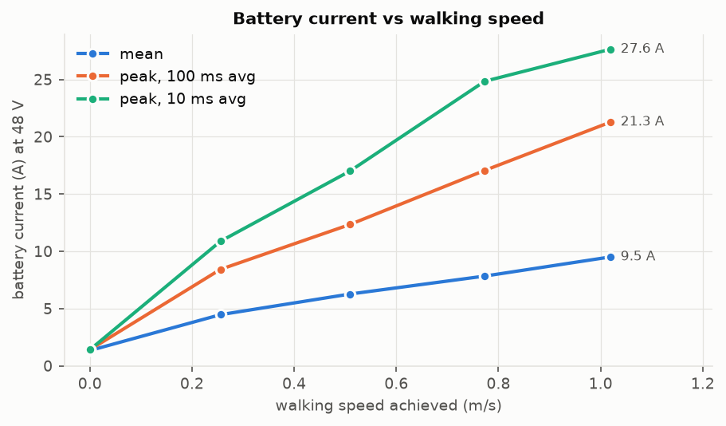
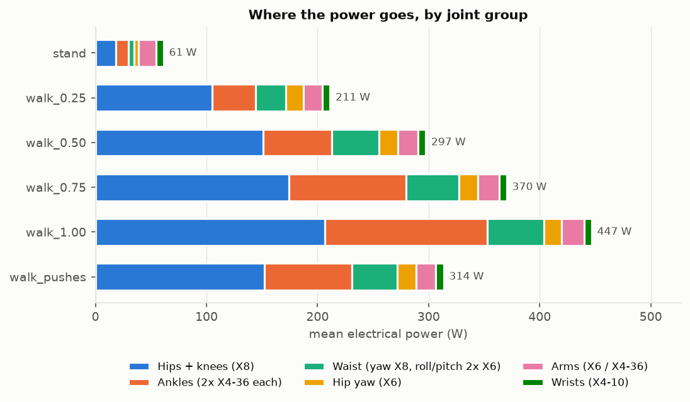
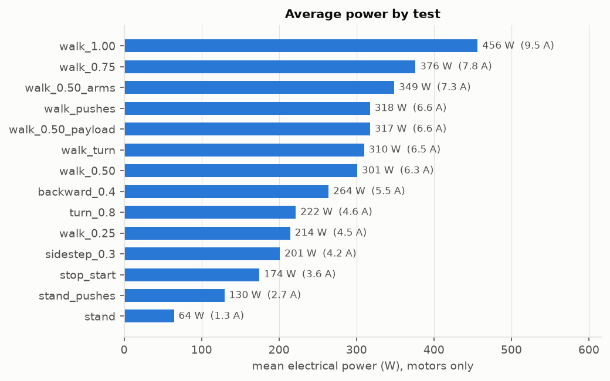
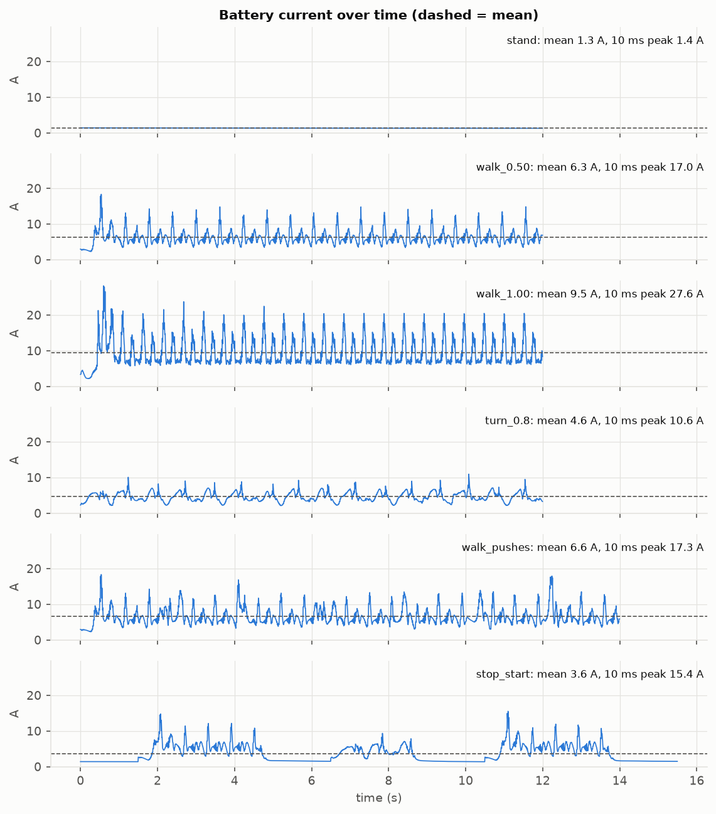
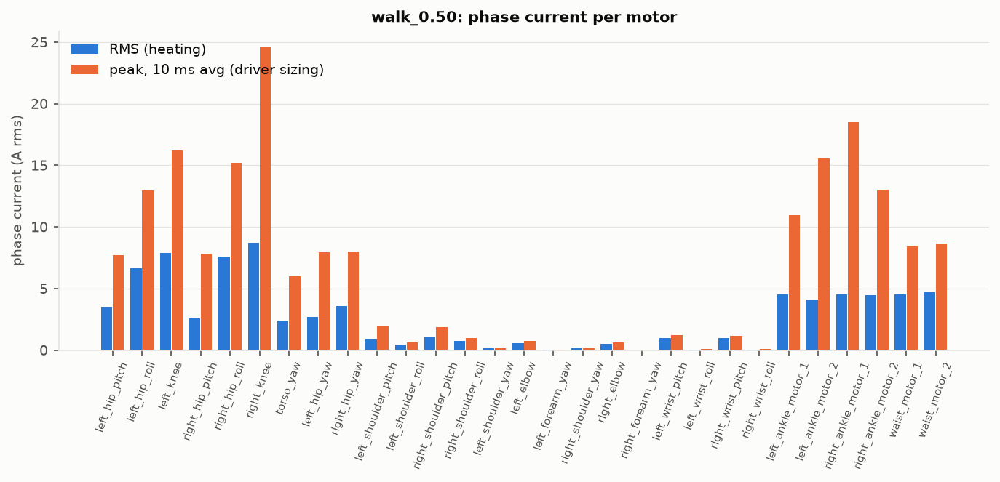
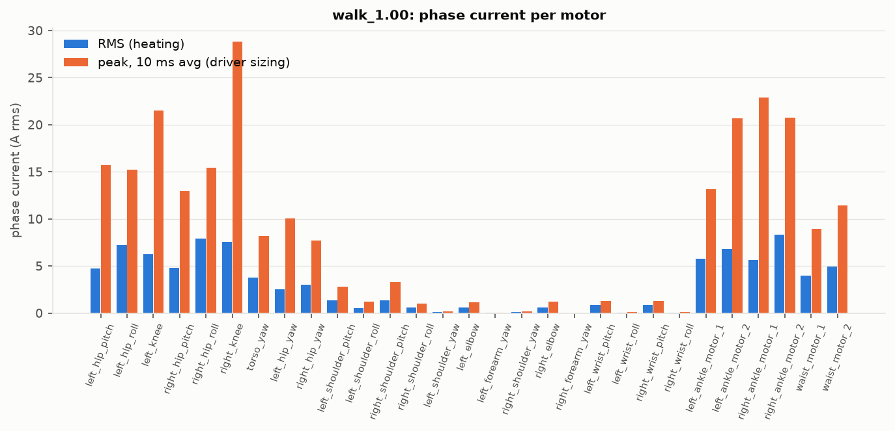
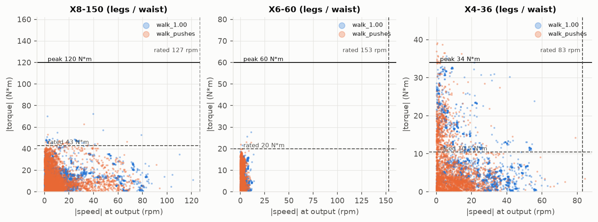
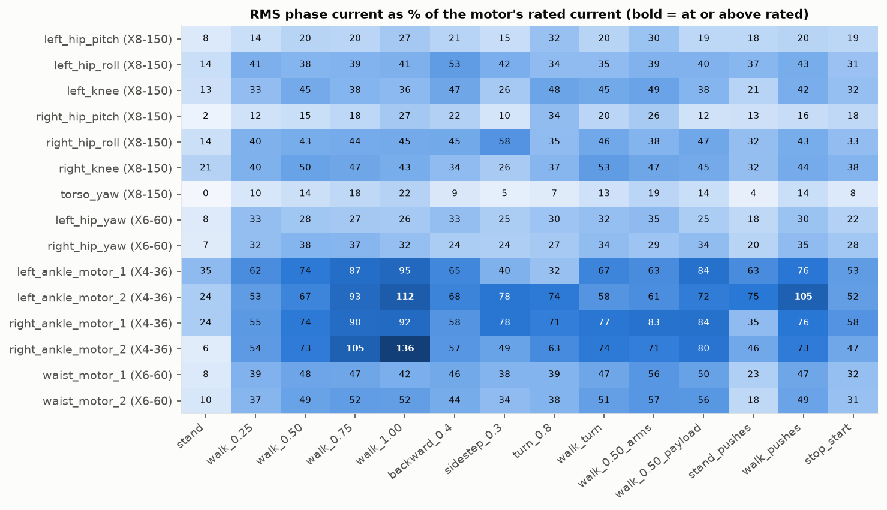

# Wisco V1: estimated motor and battery current while walking (simulation)

Generated 2026-11-12 by `robots/wisco_v1/tools/current_estimate.py` (policy `models/locomotion/wisco_v1_velocity_arms_free`, plain MuJoCo, flat empty floor). Re-run the script to regenerate.

**Speed range.** All tests stay inside what this walking policy (checkpoint J3h model_4650) was trained on: forward up to **1.0 m/s**, backward 0.4 m/s, sidestep, and turning in place. 1.0 m/s is the design walking speed of this policy; faster walking would need a policy trained for it (and the ankle findings below get worse).

**Read this first.** These are simulation estimates built from datasheet numbers, before any bench data. Use the averages for battery/energy planning with about +/-25 % uncertainty and the 10 ms / 100 ms peaks (plus margin) for driver, fuse, connector and BMS sizing. Section 6 lists what is assumed and how to firm it up.

## 1. Headline numbers

Bus: 48 V, all actuators on one bus; motors only (+0 W electronics), regeneration counted at 0 %.

| | Battery current, mean | Peak (100 ms avg) | Peak (10 ms avg) | Electrical power, mean |
|---|---|---|---|---|
| Standing | 1.3 A | 1.4 A | 1.4 A | 64 W |
| Walking 0.5 m/s | 6.3 A | 12.3 A | 17.0 A | 301 W |
| Walking 1.0 m/s | 9.5 A | 21.3 A | 27.6 A | 456 W |
| Walking + shoves | 6.6 A | 15.2 A | 17.3 A | 318 W |

Highest 100 ms battery current in any test: **21.3 A** (walk_1.00); highest 10 ms: **27.6 A**.
Energy at 0.5 m/s: **164 Wh/km** (cost of transport 1.48); at 1.0 m/s: **124 Wh/km** (CoT 1.13). Runtime per 1 kWh of usable pack: 3.3 h walking at 0.5 m/s, 15.5 h standing.





## Findings for mech / electrical

**Motors near or past their datasheet limits** (worst case over the completed tests):

- right_knee (X8-150): speed reaches 121 of 127 rpm rated (walk_1.00).
- left_ankle_motor_1 (X4-36): torque reaches 85 % of peak (29.0 N*m, walk_pushes).
- left_ankle_motor_1 (X4-36): speed reaches 79 of 83 rpm rated (walk_pushes).
- left_ankle_motor_1 (X4-36): RMS current 5.8 A = 95 % of rated (walk_1.00): watch heating in long runs.
- **left_ankle_motor_2 (X4-36): torque above the motor's peak rating**: 39.4 N*m vs 34 N*m peak (walk_pushes).
- left_ankle_motor_2 (X4-36): speed reaches 73 of 83 rpm rated (walk_pushes).
- left_ankle_motor_2 (X4-36): RMS current 6.8 A = 112 % of rated (walk_1.00): watch heating in long runs.
- **right_ankle_motor_1 (X4-36): torque above the motor's peak rating**: 36.9 N*m vs 34 N*m peak (walk_0.75).
- **right_ankle_motor_1 (X4-36): speed above rated**: 84 rpm vs 83 rated / 111 no-load (walk_pushes); torque available drops there.
- right_ankle_motor_1 (X4-36): RMS current 5.6 A = 92 % of rated (walk_1.00): watch heating in long runs.
- **right_ankle_motor_2 (X4-36): torque above the motor's peak rating**: 34.2 N*m vs 34 N*m peak (walk_1.00).
- right_ankle_motor_2 (X4-36): RMS current 8.3 A = 136 % of rated (walk_1.00): watch heating in long runs.

The ankle limits are the known weak point (hardware_observations.md, 'Ankle torque'): training clamps each ankle motor to 34 N*m through the linkage, but this plain-MuJoCo model only limits the joint, so it shows how hard the policy would like to push the ankles. On the robot those motors will saturate; currents there are capped near the X4-36 peak phase current (21.5 A).

**Sizing numbers with margin** (at 48 V, motors only; add electronics):

- Continuous battery current: up to 9.5 A mean in these tests -> plan for **12 A** (+30 %).
- Short peaks: 21.3 A over 100 ms, 27.6 A over 10 ms -> plan for **28 A / 36 A** (+30 %).
- Standing: 1.3 A (64 W), mostly copper loss holding the knees and hips.

## 2. All tests (battery side)

| Test | What | Speed achieved | Mean A | RMS A | Peak 1 s | Peak 100 ms | Peak 10 ms | Mean W | Wh/km | Fell |
|---|---|---|---|---|---|---|---|---|---|---|
| stand | standing still, arms at default | 0.00 m/s | 1.3 | 1.3 | 1.4 | 1.4 | 1.4 | 64 | - | no |
| walk_0.25 | walk forward 0.25 m/s | 0.26 m/s | 4.5 | 4.7 | 5.3 | 8.4 | 10.9 | 214 | 233 | no |
| walk_0.50 | walk forward 0.5 m/s (typical indoor) | 0.51 m/s | 6.3 | 6.6 | 7.2 | 12.3 | 17.0 | 301 | 164 | no |
| walk_0.75 | walk forward 0.75 m/s | 0.77 m/s | 7.8 | 8.4 | 9.3 | 17.1 | 24.8 | 376 | 135 | no |
| walk_1.00 | walk forward 1.0 m/s | 1.02 m/s | 9.5 | 10.3 | 11.9 | 21.3 | 27.6 | 456 | 124 | no |
| backward_0.4 | walk backward 0.4 m/s | 0.38 m/s | 5.5 | 5.7 | 6.0 | 7.8 | 9.3 | 264 | 193 | no |
| sidestep_0.3 | sidestep 0.3 m/s | 0.17 m/s | 4.2 | 4.8 | 4.7 | 9.4 | 11.5 | 201 | 331 | no |
| turn_0.8 | turn in place 0.8 rad/s | 0.07 m/s | 4.6 | 4.8 | 5.2 | 7.1 | 10.6 | 222 | 900 | no |
| walk_turn | walk 0.5 m/s while turning 0.4 rad/s | 0.53 m/s | 6.5 | 6.8 | 7.3 | 10.3 | 16.2 | 310 | 164 | no |
| walk_0.50_arms | walk 0.5 m/s with arms moving to random targets | 0.52 m/s | 7.3 | 7.6 | 8.2 | 12.1 | 17.8 | 349 | 187 | no |
| walk_0.50_payload | walk 0.5 m/s with 1 kg in each hand | 0.53 m/s | 6.6 | 6.9 | 7.6 | 13.3 | 17.9 | 317 | 168 | no |
| stand_pushes | standing, 0.5 m/s shove every 2 s (random direction) | 0.07 m/s | 2.7 | 3.0 | 4.4 | 9.7 | 13.0 | 130 | 550 | no |
| walk_pushes | walk 0.5 m/s, 0.5 m/s shove every 2 s | 0.54 m/s | 6.6 | 7.0 | 7.6 | 15.2 | 17.3 | 318 | 165 | no |
| stop_start | kitchen-like: walk 0.4 / stop / turn / stop, repeated | 0.17 m/s | 3.6 | 4.3 | 6.5 | 11.2 | 15.4 | 174 | 278 | no |





## 3. Per motor (phase current, A rms)

RMS = what heats the motor (compare with the rated phase current). Peak = what the driver must deliver (compare with the peak phase current). Worst case over all tests, then walking 0.5 m/s.

| Motor | Type | Rated / peak phase A | Worst RMS A (test) | Worst peak 10 ms A (test) | Worst peak torque N*m (% of peak) | Max speed rpm (rated) | Walk 0.5: RMS A / peak A |
|---|---|---|---|---|---|---|---|
| left_hip_pitch | X8-150 | 17.6 / 67.18 | 5.6 (turn_0.8) | 16.6 (stand_pushes) | 42.2 (35 %) | 35 (127) | 3.5 / 7.7 |
| left_hip_roll | X8-150 | 17.6 / 67.18 | 9.3 (backward_0.4) | 17.5 (walk_pushes) | 43.0 (36 %) | 18 (127) | 6.7 / 12.9 |
| left_knee | X8-150 | 17.6 / 67.18 | 8.6 (walk_0.50_arms) | 22.4 (walk_0.50_arms) | 57.7 (48 %) | 90 (127) | 7.9 / 16.2 |
| right_hip_pitch | X8-150 | 17.6 / 67.18 | 6.0 (turn_0.8) | 13.0 (walk_1.00) | 36.5 (30 %) | 45 (127) | 2.6 / 7.8 |
| right_hip_roll | X8-150 | 17.6 / 67.18 | 10.2 (sidestep_0.3) | 26.8 (sidestep_0.3) | 63.0 (53 %) | 16 (127) | 7.6 / 15.2 |
| right_knee | X8-150 | 17.6 / 67.18 | 9.4 (walk_turn) | 29.0 (walk_0.75) | 73.3 (61 %) | 121 (127) | 8.7 / 24.7 |
| torso_yaw | X8-150 | 17.6 / 67.18 | 3.8 (walk_1.00) | 8.4 (walk_0.50_arms) | 21.0 (17 %) | 25 (127) | 2.4 / 6.0 |
| left_hip_yaw | X6-60 | 9.5 / 29.1 | 3.3 (walk_0.50_arms) | 11.1 (walk_0.50_arms) | 25.1 (42 %) | 29 (153) | 2.7 / 8.0 |
| right_hip_yaw | X6-60 | 9.5 / 29.1 | 3.6 (walk_0.50) | 8.6 (stand_pushes) | 18.2 (30 %) | 26 (153) | 3.6 / 8.0 |
| left_shoulder_pitch | X6-60 | 9.5 / 29.1 | 1.4 (walk_1.00) | 3.5 (walk_0.50_arms) | 7.3 (12 %) | 24 (153) | 0.9 / 2.0 |
| left_shoulder_roll | X6-60 | 9.5 / 29.1 | 1.8 (walk_0.50_arms) | 4.4 (walk_0.50_arms) | 9.3 (16 %) | 19 (153) | 0.5 / 0.6 |
| right_shoulder_pitch | X6-60 | 9.5 / 29.1 | 1.5 (walk_0.50_arms) | 4.1 (walk_0.50_arms) | 9.0 (15 %) | 36 (153) | 1.0 / 1.9 |
| right_shoulder_roll | X6-60 | 9.5 / 29.1 | 2.4 (walk_0.50_arms) | 4.4 (walk_0.50_arms) | 9.5 (16 %) | 23 (153) | 0.7 / 1.0 |
| left_shoulder_yaw | X4-36 | 6.1 / 21.5 | 1.0 (walk_0.50_arms) | 4.0 (walk_0.50_arms) | 7.0 (21 %) | 30 (83) | 0.1 / 0.2 |
| left_elbow | X4-36 | 6.1 / 21.5 | 1.0 (walk_0.50_payload) | 2.4 (walk_0.50_arms) | 4.3 (13 %) | 30 (83) | 0.6 / 0.8 |
| left_forearm_yaw | X4-36 | 6.1 / 21.5 | 0.5 (walk_0.50_arms) | 2.0 (walk_0.50_arms) | 3.7 (11 %) | 45 (83) | 0.0 / 0.0 |
| right_shoulder_yaw | X4-36 | 6.1 / 21.5 | 0.9 (walk_0.50_arms) | 2.6 (walk_0.50_arms) | 4.7 (14 %) | 19 (83) | 0.1 / 0.2 |
| right_elbow | X4-36 | 6.1 / 21.5 | 0.9 (walk_0.50_payload) | 2.2 (walk_0.50_arms) | 3.9 (11 %) | 36 (83) | 0.5 / 0.6 |
| right_forearm_yaw | X4-36 | 6.1 / 21.5 | 0.5 (walk_0.50_arms) | 1.7 (walk_0.50_arms) | 3.0 (9 %) | 30 (83) | 0.0 / 0.0 |
| left_wrist_pitch | X4-10 | 7.8 / 19.5 | 2.2 (walk_0.50_payload) | 3.0 (walk_0.50_arms) | 1.6 (16 %) | 8 (238) | 1.0 / 1.2 |
| left_wrist_roll | X4-10 | 7.8 / 19.5 | 1.4 (walk_0.50_arms) | 4.4 (walk_0.50_arms) | 2.3 (23 %) | 22 (238) | 0.0 / 0.1 |
| right_wrist_pitch | X4-10 | 7.8 / 19.5 | 2.1 (walk_0.50_payload) | 3.7 (walk_0.50_arms) | 2.0 (20 %) | 14 (238) | 1.0 / 1.2 |
| right_wrist_roll | X4-10 | 7.8 / 19.5 | 1.0 (walk_0.50_arms) | 2.6 (walk_0.50_arms) | 1.4 (14 %) | 20 (238) | 0.0 / 0.1 |
| left_ankle_motor_1 | X4-36 | 6.1 / 21.5 | 5.8 (walk_1.00) | 16.5 (walk_pushes) | 29.0 (85 %) | 79 (83) | 4.5 / 11.0 |
| left_ankle_motor_2 | X4-36 | 6.1 / 21.5 | 6.8 (walk_1.00) | 25.4 (walk_pushes) | 39.4 (116 %) | 73 (83) | 4.1 / 15.6 |
| right_ankle_motor_1 | X4-36 | 6.1 / 21.5 | 5.6 (walk_1.00) | 23.0 (walk_0.75) | 36.9 (109 %) | 84 (83) | 4.5 / 18.5 |
| right_ankle_motor_2 | X4-36 | 6.1 / 21.5 | 8.3 (walk_1.00) | 20.8 (walk_1.00) | 34.2 (100 %) | 66 (83) | 4.4 / 13.0 |
| waist_motor_1 | X6-60 | 9.5 / 29.1 | 5.3 (walk_0.50_arms) | 12.2 (walk_0.50_arms) | 28.5 (47 %) | 10 (153) | 4.5 / 8.4 |
| waist_motor_2 | X6-60 | 9.5 / 29.1 | 5.4 (walk_0.50_arms) | 11.4 (walk_1.00) | 27.7 (46 %) | 14 (153) | 4.7 / 8.6 |









Head yaw / head pitch (X4-10) are fixed in the sim model; they are counted as idle drivers only.

## 4. How the numbers are made

1. **Simulation.** The trained walking policy runs at 50 Hz in MuJoCo (5 ms physics steps) on a flat floor. Legs and waist follow the policy; arms are held by their position controllers (default pose, or random targets in the `arms` test). Each joint's applied torque comes from the simulated PD loop with the robot's gains, limited to each joint's torque limit.
2. **Joint to motor.** Single-motor joints: motor torque/speed = joint torque/speed. Ankles (2x X4-36 each) and waist roll+pitch (2x X6-60): motor torques solve J^T tau_motor = tau_joint, motor speeds = J q_dot, with J the linkage Jacobian (ankles: at the current pose, from `ankle_linkage.json`; waist: at the zero pose).
3. **Torque to phase current.** Piecewise-linear through (0, 0) and the datasheet's torque/current points (rated, stall table, peak), so the torque constant falls at high torque as on the sheets.
4. **Electrical power per actuator** = tau x omega (mechanical out; negative = braking) + gearbox/bearing loss 5.4 % of |tau x omega| + copper loss 1.5 x R_line x I_rms^2 (Y winding) + spinning loss 1.55 x V_rated x I_noload x speed / no-load speed + driver idle 1.5 W. The two loss factors were fitted to the X8 load test below (the only measured efficiency table we have).
5. **Battery current** = (sum of actuator power, braking power returned at 0 %, + 2 idle head drivers + 0 W electronics) / 48 V bus. Peaks are also given as 10 ms, 100 ms and 1 s moving averages (raw 5 ms values include foot-impact spikes).

### Check against a measurement (X8 load test from its datasheet, 48 V, about 100-126 rpm)

| Torque N*m | rpm | Measured input W | Model W | Error | Measured bus A | Model bus A |
|---|---|---|---|---|---|---|
| 0.8 | 124 | 90 | 106 | +18 % | 1.88 | 2.21 |
| 1.4 | 126 | 126 | 116 | -8 % | 2.64 | 2.42 |
| 4.9 | 126 | 171 | 166 | -3 % | 3.57 | 3.46 |
| 9.5 | 125 | 232 | 231 | -1 % | 4.86 | 4.83 |
| 15.1 | 124 | 316 | 312 | -1 % | 6.63 | 6.54 |
| 21.7 | 122 | 420 | 407 | -3 % | 8.82 | 8.54 |
| 29.2 | 123 | 541 | 529 | -2 % | 11.38 | 11.13 |
| 37.4 | 125 | 650 | 675 | +4 % | 13.70 | 14.22 |
| 45.9 | 124 | 826 | 820 | -1 % | 17.47 | 17.32 |
| 54.9 | 123 | 963 | 984 | +2 % | 20.40 | 20.84 |
| 64.8 | 118 | 1095 | 1142 | +4 % | 23.27 | 24.25 |
| 74.9 | 113 | 1334 | 1304 | -2 % | 28.44 | 27.78 |
| 85.2 | 106 | 1497 | 1451 | -3 % | 31.72 | 31.00 |
| 95.8 | 100 | 1589 | 1612 | +1 % | 35.27 | 34.53 |

Above 5 N*m the model is within 4 % (median 2 %) of the measured input power (the loss factors were fitted to this same table, so this shows the model form fits; it is not an independent test). Walking is mostly high torque at low speed, where the copper term dominates.

## 5. Every number used

### Motors (MyActuator parameter sheets, `robots/wisco_v1/model/motor_datasheets/`)

| | X8-150 | X6-60 | X4-36 | X4-10 |
|---|---|---|---|---|
| Model | RMD-X8-P20-150-E | RMD-X6-P20-60-E | RMD-X4-P36-36-E | RMD-X4-P12.5-10-E |
| Gear ratio | 19.612 | 19.612 | 36 | 12.5 |
| Rated voltage V | 48 | 48 | 24 | 24 |
| Voltage range V | (20, 55) | (20, 55) | (20, 55) | (20, 55) |
| No-load current A | 1.6 | 0.9 | 0.9 | 1.0 |
| No-load speed rpm (output) | 158 | 176 | 111 | 317 |
| Rated speed rpm | 127 | 153 | 83 | 238 |
| Rated torque N*m | 43 | 20 | 10.5 | 4 |
| Peak torque N*m | 120 | 60 | 34 | 10 |
| Stall torque N*m | 150 | 60 | 34.5 | 8 |
| Module torque constant (sheet) N*m/A | 2.97 | 2.1 | 1.9 | 0.8 |
| Line resistance ohm | 0.18 | 0.41 | 0.39 | 0.32 |
| Line inductance mH | 0.33 | 0.51 | 0.07 | 0.14 |
| Back-EMF Vdc/krpm | 13.74 | 16 | 6 | 6 |
| Efficiency (sheet) | 0.75 | 0.727 | 0.631 | 0.695 |
| Mass kg | 1.33 | 0.82 | 0.36 | 0.33 |
| Torque/current points (N*m, A rms) | [(43, 17.6), (150, 67.18)] | [(20, 9.5), (30, 12.7), (40, 17.7), (50, 22.6), (60, 28.3)] | [(10.5, 6.1), (17.25, 9.2), (23, 12.7), (28.75, 16.3), (34.5, 21.2)] | [(4, 7.8), (6, 9.1), (7.2, 11.0), (8, 12.1), (10, 19.5)] |

Count on the robot: X8-150 x7, X6-60 x8, X4-36 x10, X4-10 x6 (31 actuators; 4 of the X4-36 drive the ankles in pairs, 2 of the X6-60 drive the waist in a pair).

### Joint to motor

- X8-150: left_hip_pitch, left_hip_roll, left_knee, right_hip_pitch, right_hip_roll, right_knee, torso_yaw
- X6-60: left_hip_yaw, right_hip_yaw, left_shoulder_pitch, left_shoulder_roll, right_shoulder_pitch, right_shoulder_roll
- X4-36: left_shoulder_yaw, left_elbow, left_forearm_yaw, right_shoulder_yaw, right_elbow, right_forearm_yaw
- X4-10: left_wrist_pitch, left_wrist_roll, right_wrist_pitch, right_wrist_roll
- 2x X4-36 per ankle (pitch + roll through the rod linkage), 2x X6-60 for waist roll + pitch, X4-10: head yaw, head pitch (fixed in sim)

### Robot and simulation

- Robot mass in the sim model: 40.6 kg (from CAD, scaled +0-20 % in training for wiring etc.)
- Joint torque limits = motor peak torque (X8 120, X6 60, X4-36 34, X4-10 10 N*m; ankles/waist in joint space through the linkage)
- Controller: joint PD on the driver at 50 Hz policy rate, gains from `robot_numbers.yaml` (hips/knees kp 120, hip yaw 50, ankles 35, waist 100)
- Bus voltage 48 V (**assumed**, `robot_numbers.yaml` bus.supply_voltage_v is not set yet), regeneration 0 % (**assumed**: drivers not known to return energy), driver idle 1.5 W each (**assumed**), electronics 0 W (**not included unless set**)

## 6. Limits of this estimate and how to firm it up

- **Simulated gait.** Real walking has more foot slip, uneven floors and controller effort; add 20-30 % margin to means and size hardware on the 100 ms / 10 ms peaks plus margin.
- **Losses** are fitted to one measured table (X8). The X6/X4 use the same loss fractions; their own efficiency tables would firm this up. Losses while the joint is back-driven (braking) use the same terms.
- **Torque constant**: the sheets' module constant disagrees with their own rated torque/current pair for some motors (e.g. X8: 2.97 N*m/A listed, 43 N*m / 17.6 A = 2.44 N*m/A); the model uses the torque/current pairs.
- **Plain MuJoCo deploy model**: no motor torque-speed droop and no per-motor ankle clamp (training had both); operating points beyond the rated speed or near peak torque in section 3 are where the real robot would be limited.
- **Bus voltage / regeneration / electronics** are assumptions; rerun with `--bus-v`, `--regen`, `--electronics-w`.
- **Thermal**: RMS current over 10-14 s tests; long-duration heating needs a thermal model or a bench run.
- **Firm it up**: (1) bench each motor type at 3-4 held torques, log driver current and bus current, replace the torque-current points; (2) log bus current on the robot walking and compare with section 2.

## 7. Re-running

```bash
.venv-mjlab/bin/python robots/wisco_v1/tools/current_estimate.py --bus-v 48 --regen 0 --electronics-w 0
```
Writes REPORT.md and REPORT.pdf (same content, graphs embedded; the PDF needs Google Chrome on the Mac).
The same per-motor numbers are also written as CSV files next to this report (one per test), for spreadsheets; everything in them is in the appendix below.

## Appendix: per-motor results for every test

Phase current in A rms. RMS = heating over the test; peak 10 ms = highest 10 ms average (driver sizing); raw peak = single 5 ms sample (includes foot-impact spikes). Torque and speed at the motor output (ankle and waist motors after the linkage). Mean W = average electrical input power of that actuator. % > rated = share of time above the rated torque.

### stand: standing still, arms at default

Speed achieved 0.00 m/s; battery current mean 1.3 A, peak 100 ms 1.4 A, peak 10 ms 1.4 A; mean power 64 W.

| Motor | Type | RMS A | Peak 10 ms A | Raw peak A | RMS torque N*m | Peak torque N*m (% of peak) | Peak rpm | Mean W | % > rated torque |
|---|---|---|---|---|---|---|---|---|---|
| left_hip_pitch | X8-150 | 1.4 | 1.5 | 1.5 | 3.3 | 3.7 (3 %) | 0 | 2.0 | 0.0 |
| left_hip_roll | X8-150 | 2.5 | 3.5 | 3.5 | 6.2 | 8.7 (7 %) | 0 | 3.3 | 0.0 |
| left_knee | X8-150 | 2.3 | 2.7 | 2.7 | 5.6 | 6.6 (5 %) | 0 | 2.9 | 0.0 |
| right_hip_pitch | X8-150 | 0.3 | 0.5 | 0.5 | 0.8 | 1.2 (1 %) | 0 | 1.5 | 0.0 |
| right_hip_roll | X8-150 | 2.4 | 3.7 | 3.7 | 6.0 | 8.9 (7 %) | 0 | 3.1 | 0.0 |
| right_knee | X8-150 | 3.8 | 3.9 | 3.9 | 9.2 | 9.6 (8 %) | 0 | 5.4 | 0.0 |
| torso_yaw | X8-150 | 0.0 | 0.1 | 0.1 | 0.1 | 0.1 (0 %) | 0 | 1.5 | 0.0 |
| left_hip_yaw | X6-60 | 0.7 | 1.1 | 1.1 | 1.5 | 2.4 (4 %) | 0 | 1.8 | 0.0 |
| right_hip_yaw | X6-60 | 0.6 | 1.2 | 1.2 | 1.3 | 2.5 (4 %) | 0 | 1.8 | 0.0 |
| left_shoulder_pitch | X6-60 | 0.5 | 0.6 | 0.6 | 1.1 | 1.2 (2 %) | 0 | 1.7 | 0.0 |
| left_shoulder_roll | X6-60 | 0.5 | 0.6 | 0.6 | 1.0 | 1.2 (2 %) | 0 | 1.6 | 0.0 |
| right_shoulder_pitch | X6-60 | 0.5 | 0.6 | 0.6 | 1.1 | 1.2 (2 %) | 0 | 1.7 | 0.0 |
| right_shoulder_roll | X6-60 | 0.5 | 0.6 | 0.6 | 1.0 | 1.2 (2 %) | 0 | 1.6 | 0.0 |
| left_shoulder_yaw | X4-36 | 0.2 | 0.2 | 0.2 | 0.3 | 0.3 (1 %) | 0 | 1.5 | 0.0 |
| left_elbow | X4-36 | 0.5 | 0.5 | 0.5 | 0.8 | 0.9 (3 %) | 0 | 1.6 | 0.0 |
| left_forearm_yaw | X4-36 | 0.0 | 0.0 | 0.0 | 0.0 | 0.0 (0 %) | 0 | 1.5 | 0.0 |
| right_shoulder_yaw | X4-36 | 0.2 | 0.2 | 0.2 | 0.3 | 0.3 (1 %) | 0 | 1.5 | 0.0 |
| right_elbow | X4-36 | 0.5 | 0.5 | 0.5 | 0.8 | 0.9 (3 %) | 0 | 1.6 | 0.0 |
| right_forearm_yaw | X4-36 | 0.0 | 0.0 | 0.0 | 0.0 | 0.0 (0 %) | 0 | 1.5 | 0.0 |
| left_wrist_pitch | X4-10 | 0.9 | 1.0 | 1.0 | 0.5 | 0.5 (5 %) | 0 | 1.9 | 0.0 |
| left_wrist_roll | X4-10 | 0.1 | 0.1 | 0.1 | 0.0 | 0.0 (0 %) | 0 | 1.5 | 0.0 |
| right_wrist_pitch | X4-10 | 0.9 | 0.9 | 0.9 | 0.5 | 0.5 (5 %) | 0 | 1.9 | 0.0 |
| right_wrist_roll | X4-10 | 0.1 | 0.1 | 0.1 | 0.0 | 0.0 (0 %) | 0 | 1.5 | 0.0 |
| left_ankle_motor_1 | X4-36 | 2.1 | 2.4 | 2.4 | 3.7 | 4.2 (12 %) | 0 | 4.2 | 0.0 |
| left_ankle_motor_2 | X4-36 | 1.5 | 1.9 | 1.9 | 2.5 | 3.2 (9 %) | 0 | 2.8 | 0.0 |
| right_ankle_motor_1 | X4-36 | 1.5 | 1.9 | 1.9 | 2.5 | 3.3 (10 %) | 0 | 2.8 | 0.0 |
| right_ankle_motor_2 | X4-36 | 0.4 | 0.7 | 0.7 | 0.7 | 1.2 (4 %) | 0 | 1.6 | 0.0 |
| waist_motor_1 | X6-60 | 0.7 | 1.1 | 1.1 | 1.5 | 2.3 (4 %) | 0 | 1.8 | 0.0 |
| waist_motor_2 | X6-60 | 0.9 | 1.0 | 1.0 | 2.0 | 2.2 (4 %) | 0 | 2.0 | 0.0 |

### walk_0.25: walk forward 0.25 m/s

Speed achieved 0.26 m/s; battery current mean 4.5 A, peak 100 ms 8.4 A, peak 10 ms 10.9 A; mean power 214 W.

| Motor | Type | RMS A | Peak 10 ms A | Raw peak A | RMS torque N*m | Peak torque N*m (% of peak) | Peak rpm | Mean W | % > rated torque |
|---|---|---|---|---|---|---|---|---|---|
| left_hip_pitch | X8-150 | 2.5 | 6.6 | 6.6 | 6.2 | 16.1 (13 %) | 18 | 6.7 | 0.0 |
| left_hip_roll | X8-150 | 7.3 | 14.9 | 14.9 | 17.8 | 36.4 (30 %) | 8 | 18.2 | 0.0 |
| left_knee | X8-150 | 5.8 | 13.7 | 14.5 | 14.2 | 35.5 (30 %) | 47 | 22.2 | 0.0 |
| right_hip_pitch | X8-150 | 2.2 | 6.9 | 7.6 | 5.3 | 18.5 (15 %) | 31 | 9.6 | 0.0 |
| right_hip_roll | X8-150 | 7.1 | 14.3 | 14.3 | 17.4 | 35.0 (29 %) | 6 | 16.6 | 0.0 |
| right_knee | X8-150 | 7.0 | 16.7 | 17.9 | 17.2 | 43.7 (36 %) | 68 | 31.5 | 0.0 |
| torso_yaw | X8-150 | 1.7 | 4.9 | 5.2 | 4.1 | 12.7 (11 %) | 11 | 6.4 | 0.0 |
| left_hip_yaw | X6-60 | 3.1 | 7.6 | 7.6 | 6.5 | 15.9 (27 %) | 5 | 8.1 | 0.0 |
| right_hip_yaw | X6-60 | 3.1 | 6.5 | 6.5 | 6.5 | 13.8 (23 %) | 8 | 7.5 | 0.0 |
| left_shoulder_pitch | X6-60 | 0.8 | 1.3 | 1.3 | 1.7 | 2.8 (5 %) | 4 | 2.1 | 0.0 |
| left_shoulder_roll | X6-60 | 0.5 | 0.7 | 0.7 | 1.1 | 1.6 (3 %) | 1 | 1.7 | 0.0 |
| right_shoulder_pitch | X6-60 | 0.8 | 1.4 | 1.4 | 1.7 | 3.0 (5 %) | 3 | 2.1 | 0.0 |
| right_shoulder_roll | X6-60 | 0.5 | 0.7 | 0.7 | 1.2 | 1.4 (2 %) | 2 | 1.7 | 0.0 |
| left_shoulder_yaw | X4-36 | 0.2 | 0.2 | 0.2 | 0.3 | 0.3 (1 %) | 0 | 1.5 | 0.0 |
| left_elbow | X4-36 | 0.6 | 0.6 | 0.6 | 0.9 | 1.0 (3 %) | 0 | 1.7 | 0.0 |
| left_forearm_yaw | X4-36 | 0.0 | 0.0 | 0.0 | 0.0 | 0.0 (0 %) | 0 | 1.5 | 0.0 |
| right_shoulder_yaw | X4-36 | 0.1 | 0.2 | 0.2 | 0.2 | 0.3 (1 %) | 0 | 1.5 | 0.0 |
| right_elbow | X4-36 | 0.6 | 0.6 | 0.6 | 0.9 | 1.0 (3 %) | 1 | 1.7 | 0.0 |
| right_forearm_yaw | X4-36 | 0.0 | 0.0 | 0.0 | 0.0 | 0.0 (0 %) | 0 | 1.5 | 0.0 |
| left_wrist_pitch | X4-10 | 1.0 | 1.2 | 1.2 | 0.5 | 0.6 (6 %) | 1 | 2.0 | 0.0 |
| left_wrist_roll | X4-10 | 0.1 | 0.1 | 0.1 | 0.0 | 0.0 (0 %) | 0 | 1.5 | 0.0 |
| right_wrist_pitch | X4-10 | 1.0 | 1.1 | 1.1 | 0.5 | 0.6 (6 %) | 1 | 2.0 | 0.0 |
| right_wrist_roll | X4-10 | 0.1 | 0.1 | 0.1 | 0.0 | 0.0 (0 %) | 0 | 1.5 | 0.0 |
| left_ankle_motor_1 | X4-36 | 3.8 | 10.0 | 10.0 | 6.6 | 18.6 (55 %) | 26 | 9.9 | 17.8 |
| left_ankle_motor_2 | X4-36 | 3.2 | 10.5 | 10.5 | 5.6 | 19.4 (57 %) | 24 | 9.5 | 2.5 |
| right_ankle_motor_1 | X4-36 | 3.4 | 16.0 | 16.0 | 5.9 | 28.3 (83 %) | 35 | 9.5 | 3.5 |
| right_ankle_motor_2 | X4-36 | 3.3 | 9.6 | 9.6 | 5.9 | 17.9 (53 %) | 29 | 10.4 | 11.2 |
| waist_motor_1 | X6-60 | 3.7 | 8.5 | 8.5 | 7.9 | 18.0 (30 %) | 4 | 11.0 | 0.0 |
| waist_motor_2 | X6-60 | 3.6 | 8.0 | 8.0 | 7.5 | 16.9 (28 %) | 6 | 10.0 | 0.0 |

### walk_0.50: walk forward 0.5 m/s (typical indoor)

Speed achieved 0.51 m/s; battery current mean 6.3 A, peak 100 ms 12.3 A, peak 10 ms 17.0 A; mean power 301 W.

| Motor | Type | RMS A | Peak 10 ms A | Raw peak A | RMS torque N*m | Peak torque N*m (% of peak) | Peak rpm | Mean W | % > rated torque |
|---|---|---|---|---|---|---|---|---|---|
| left_hip_pitch | X8-150 | 3.5 | 7.7 | 8.7 | 8.6 | 21.2 (18 %) | 21 | 10.3 | 0.0 |
| left_hip_roll | X8-150 | 6.7 | 12.9 | 13.0 | 16.3 | 31.6 (26 %) | 10 | 16.4 | 0.0 |
| left_knee | X8-150 | 7.9 | 16.2 | 17.1 | 19.2 | 41.9 (35 %) | 59 | 40.4 | 0.0 |
| right_hip_pitch | X8-150 | 2.6 | 7.8 | 8.6 | 6.3 | 21.1 (18 %) | 37 | 12.2 | 0.0 |
| right_hip_roll | X8-150 | 7.6 | 15.2 | 15.3 | 18.6 | 37.3 (31 %) | 12 | 21.2 | 0.0 |
| right_knee | X8-150 | 8.7 | 24.7 | 26.7 | 21.3 | 62.7 (52 %) | 96 | 50.7 | 1.2 |
| torso_yaw | X8-150 | 2.4 | 6.0 | 6.4 | 5.9 | 15.5 (13 %) | 17 | 10.4 | 0.0 |
| left_hip_yaw | X6-60 | 2.7 | 8.0 | 8.0 | 5.6 | 16.8 (28 %) | 5 | 6.7 | 0.0 |
| right_hip_yaw | X6-60 | 3.6 | 8.0 | 8.0 | 7.6 | 16.9 (28 %) | 9 | 10.4 | 0.0 |
| left_shoulder_pitch | X6-60 | 0.9 | 2.0 | 2.0 | 2.0 | 4.2 (7 %) | 6 | 2.4 | 0.0 |
| left_shoulder_roll | X6-60 | 0.5 | 0.6 | 0.6 | 1.0 | 1.3 (2 %) | 1 | 1.7 | 0.0 |
| right_shoulder_pitch | X6-60 | 1.0 | 1.9 | 1.9 | 2.1 | 3.9 (7 %) | 6 | 2.6 | 0.0 |
| right_shoulder_roll | X6-60 | 0.7 | 1.0 | 1.0 | 1.6 | 2.2 (4 %) | 3 | 1.9 | 0.0 |
| left_shoulder_yaw | X4-36 | 0.1 | 0.2 | 0.2 | 0.2 | 0.3 (1 %) | 0 | 1.5 | 0.0 |
| left_elbow | X4-36 | 0.6 | 0.8 | 0.8 | 1.0 | 1.3 (4 %) | 2 | 1.8 | 0.0 |
| left_forearm_yaw | X4-36 | 0.0 | 0.0 | 0.0 | 0.0 | 0.0 (0 %) | 0 | 1.5 | 0.0 |
| right_shoulder_yaw | X4-36 | 0.1 | 0.2 | 0.2 | 0.2 | 0.3 (1 %) | 0 | 1.5 | 0.0 |
| right_elbow | X4-36 | 0.5 | 0.6 | 0.6 | 0.9 | 1.1 (3 %) | 1 | 1.7 | 0.0 |
| right_forearm_yaw | X4-36 | 0.0 | 0.0 | 0.0 | 0.0 | 0.0 (0 %) | 0 | 1.5 | 0.0 |
| left_wrist_pitch | X4-10 | 1.0 | 1.2 | 1.2 | 0.5 | 0.6 (6 %) | 1 | 2.0 | 0.0 |
| left_wrist_roll | X4-10 | 0.0 | 0.1 | 0.1 | 0.0 | 0.0 (0 %) | 0 | 1.5 | 0.0 |
| right_wrist_pitch | X4-10 | 1.0 | 1.2 | 1.2 | 0.5 | 0.6 (6 %) | 1 | 2.0 | 0.0 |
| right_wrist_roll | X4-10 | 0.0 | 0.1 | 0.1 | 0.0 | 0.1 (1 %) | 0 | 1.5 | 0.0 |
| left_ankle_motor_1 | X4-36 | 4.5 | 11.0 | 11.0 | 8.2 | 20.2 (59 %) | 43 | 15.9 | 19.8 |
| left_ankle_motor_2 | X4-36 | 4.1 | 15.6 | 15.6 | 7.4 | 27.6 (81 %) | 38 | 13.6 | 15.6 |
| right_ankle_motor_1 | X4-36 | 4.5 | 18.5 | 18.5 | 8.2 | 31.4 (92 %) | 35 | 15.6 | 17.8 |
| right_ankle_motor_2 | X4-36 | 4.4 | 13.0 | 13.0 | 8.0 | 23.5 (69 %) | 27 | 16.4 | 14.6 |
| waist_motor_1 | X6-60 | 4.5 | 8.4 | 8.5 | 9.6 | 17.8 (30 %) | 7 | 15.8 | 0.0 |
| waist_motor_2 | X6-60 | 4.7 | 8.6 | 8.7 | 9.9 | 18.3 (31 %) | 11 | 16.2 | 0.0 |

### walk_0.75: walk forward 0.75 m/s

Speed achieved 0.77 m/s; battery current mean 7.8 A, peak 100 ms 17.1 A, peak 10 ms 24.8 A; mean power 376 W.

| Motor | Type | RMS A | Peak 10 ms A | Raw peak A | RMS torque N*m | Peak torque N*m (% of peak) | Peak rpm | Mean W | % > rated torque |
|---|---|---|---|---|---|---|---|---|---|
| left_hip_pitch | X8-150 | 3.5 | 9.7 | 11.0 | 8.5 | 26.8 (22 %) | 29 | 19.4 | 0.0 |
| left_hip_roll | X8-150 | 6.9 | 13.1 | 13.2 | 16.9 | 32.2 (27 %) | 13 | 17.2 | 0.0 |
| left_knee | X8-150 | 6.6 | 16.6 | 17.7 | 16.1 | 43.2 (36 %) | 72 | 40.5 | 0.0 |
| right_hip_pitch | X8-150 | 3.3 | 10.5 | 12.6 | 7.9 | 30.8 (26 %) | 41 | 22.7 | 0.0 |
| right_hip_roll | X8-150 | 7.7 | 15.3 | 15.5 | 18.9 | 37.9 (32 %) | 14 | 21.8 | 0.0 |
| right_knee | X8-150 | 8.3 | 29.0 | 31.6 | 20.1 | 73.3 (61 %) | 116 | 52.6 | 1.5 |
| torso_yaw | X8-150 | 3.1 | 7.2 | 7.5 | 7.6 | 18.3 (15 %) | 20 | 14.8 | 0.0 |
| left_hip_yaw | X6-60 | 2.6 | 10.1 | 10.1 | 5.4 | 22.0 (37 %) | 10 | 6.6 | 0.2 |
| right_hip_yaw | X6-60 | 3.5 | 7.6 | 7.6 | 7.4 | 16.1 (27 %) | 12 | 10.2 | 0.0 |
| left_shoulder_pitch | X6-60 | 1.1 | 2.4 | 2.4 | 2.3 | 5.0 (8 %) | 7 | 2.9 | 0.0 |
| left_shoulder_roll | X6-60 | 0.4 | 0.7 | 0.7 | 0.8 | 1.4 (2 %) | 2 | 1.7 | 0.0 |
| right_shoulder_pitch | X6-60 | 1.1 | 2.4 | 2.4 | 2.4 | 5.0 (8 %) | 7 | 2.9 | 0.0 |
| right_shoulder_roll | X6-60 | 0.7 | 1.0 | 1.0 | 1.4 | 2.1 (4 %) | 3 | 1.9 | 0.0 |
| left_shoulder_yaw | X4-36 | 0.1 | 0.2 | 0.2 | 0.2 | 0.3 (1 %) | 0 | 1.5 | 0.0 |
| left_elbow | X4-36 | 0.5 | 0.9 | 0.9 | 0.9 | 1.5 (4 %) | 3 | 1.8 | 0.0 |
| left_forearm_yaw | X4-36 | 0.0 | 0.0 | 0.0 | 0.0 | 0.0 (0 %) | 0 | 1.5 | 0.0 |
| right_shoulder_yaw | X4-36 | 0.1 | 0.2 | 0.2 | 0.2 | 0.3 (1 %) | 0 | 1.5 | 0.0 |
| right_elbow | X4-36 | 0.5 | 0.9 | 0.9 | 0.9 | 1.5 (4 %) | 2 | 1.8 | 0.0 |
| right_forearm_yaw | X4-36 | 0.0 | 0.0 | 0.0 | 0.0 | 0.0 (0 %) | 0 | 1.5 | 0.0 |
| left_wrist_pitch | X4-10 | 0.9 | 1.3 | 1.3 | 0.5 | 0.7 (7 %) | 1 | 2.0 | 0.0 |
| left_wrist_roll | X4-10 | 0.1 | 0.1 | 0.1 | 0.0 | 0.1 (1 %) | 0 | 1.5 | 0.0 |
| right_wrist_pitch | X4-10 | 0.9 | 1.2 | 1.2 | 0.5 | 0.6 (6 %) | 1 | 1.9 | 0.0 |
| right_wrist_roll | X4-10 | 0.0 | 0.1 | 0.1 | 0.0 | 0.1 (1 %) | 0 | 1.5 | 0.0 |
| left_ankle_motor_1 | X4-36 | 5.3 | 12.7 | 12.7 | 9.6 | 23.0 (68 %) | 51 | 22.1 | 24.1 |
| left_ankle_motor_2 | X4-36 | 5.7 | 21.7 | 21.7 | 10.2 | 35.1 (103 %) | 48 | 25.0 | 26.6 |
| right_ankle_motor_1 | X4-36 | 5.5 | 23.0 | 23.3 | 9.9 | 36.9 (109 %) | 47 | 24.7 | 22.3 |
| right_ankle_motor_2 | X4-36 | 6.4 | 17.1 | 17.3 | 11.5 | 29.9 (88 %) | 48 | 33.6 | 24.8 |
| waist_motor_1 | X6-60 | 4.5 | 8.5 | 8.6 | 9.5 | 18.1 (30 %) | 9 | 15.0 | 0.0 |
| waist_motor_2 | X6-60 | 5.0 | 10.1 | 10.2 | 10.4 | 22.3 (37 %) | 12 | 18.1 | 0.1 |

### walk_1.00: walk forward 1.0 m/s

Speed achieved 1.02 m/s; battery current mean 9.5 A, peak 100 ms 21.3 A, peak 10 ms 27.6 A; mean power 456 W.

| Motor | Type | RMS A | Peak 10 ms A | Raw peak A | RMS torque N*m | Peak torque N*m (% of peak) | Peak rpm | Mean W | % > rated torque |
|---|---|---|---|---|---|---|---|---|---|
| left_hip_pitch | X8-150 | 4.8 | 15.7 | 17.3 | 11.6 | 42.2 (35 %) | 35 | 33.4 | 0.0 |
| left_hip_roll | X8-150 | 7.2 | 15.2 | 15.4 | 17.6 | 37.7 (31 %) | 12 | 18.9 | 0.0 |
| left_knee | X8-150 | 6.3 | 21.5 | 24.1 | 15.3 | 57.1 (48 %) | 90 | 41.9 | 0.2 |
| right_hip_pitch | X8-150 | 4.8 | 13.0 | 14.9 | 11.8 | 36.5 (30 %) | 45 | 38.2 | 0.0 |
| right_hip_roll | X8-150 | 7.9 | 15.4 | 15.6 | 19.4 | 38.1 (32 %) | 14 | 22.1 | 0.0 |
| right_knee | X8-150 | 7.5 | 28.8 | 31.2 | 18.4 | 72.3 (60 %) | 121 | 52.1 | 2.6 |
| torso_yaw | X8-150 | 3.8 | 8.2 | 8.6 | 9.3 | 21.0 (17 %) | 25 | 19.8 | 0.0 |
| left_hip_yaw | X6-60 | 2.5 | 10.0 | 10.0 | 5.3 | 21.7 (36 %) | 13 | 7.1 | 0.2 |
| right_hip_yaw | X6-60 | 3.0 | 7.7 | 7.7 | 6.4 | 16.2 (27 %) | 14 | 8.6 | 0.0 |
| left_shoulder_pitch | X6-60 | 1.4 | 2.8 | 2.8 | 2.9 | 5.9 (10 %) | 9 | 3.3 | 0.0 |
| left_shoulder_roll | X6-60 | 0.5 | 1.2 | 1.3 | 1.1 | 2.6 (4 %) | 4 | 1.8 | 0.0 |
| right_shoulder_pitch | X6-60 | 1.3 | 3.3 | 3.3 | 2.8 | 7.0 (12 %) | 10 | 3.2 | 0.0 |
| right_shoulder_roll | X6-60 | 0.6 | 1.0 | 1.0 | 1.2 | 2.2 (4 %) | 3 | 1.8 | 0.0 |
| left_shoulder_yaw | X4-36 | 0.1 | 0.2 | 0.2 | 0.2 | 0.3 (1 %) | 0 | 1.5 | 0.0 |
| left_elbow | X4-36 | 0.6 | 1.2 | 1.2 | 1.0 | 2.0 (6 %) | 4 | 2.1 | 0.0 |
| left_forearm_yaw | X4-36 | 0.0 | 0.0 | 0.0 | 0.0 | 0.0 (0 %) | 0 | 1.5 | 0.0 |
| right_shoulder_yaw | X4-36 | 0.1 | 0.2 | 0.2 | 0.2 | 0.3 (1 %) | 0 | 1.5 | 0.0 |
| right_elbow | X4-36 | 0.6 | 1.2 | 1.2 | 1.0 | 2.1 (6 %) | 5 | 2.0 | 0.0 |
| right_forearm_yaw | X4-36 | 0.0 | 0.0 | 0.0 | 0.0 | 0.0 (0 %) | 0 | 1.5 | 0.0 |
| left_wrist_pitch | X4-10 | 0.9 | 1.3 | 1.3 | 0.5 | 0.6 (6 %) | 1 | 1.9 | 0.0 |
| left_wrist_roll | X4-10 | 0.1 | 0.1 | 0.1 | 0.0 | 0.1 (1 %) | 0 | 1.5 | 0.0 |
| right_wrist_pitch | X4-10 | 0.9 | 1.3 | 1.3 | 0.5 | 0.7 (7 %) | 1 | 1.9 | 0.0 |
| right_wrist_roll | X4-10 | 0.0 | 0.1 | 0.1 | 0.0 | 0.1 (1 %) | 0 | 1.5 | 0.0 |
| left_ankle_motor_1 | X4-36 | 5.8 | 13.1 | 13.1 | 10.5 | 23.7 (70 %) | 62 | 27.5 | 29.6 |
| left_ankle_motor_2 | X4-36 | 6.8 | 20.7 | 20.8 | 12.1 | 34.0 (100 %) | 58 | 35.3 | 32.7 |
| right_ankle_motor_1 | X4-36 | 5.6 | 22.9 | 23.1 | 10.1 | 36.7 (108 %) | 69 | 28.2 | 24.2 |
| right_ankle_motor_2 | X4-36 | 8.3 | 20.8 | 20.9 | 14.5 | 34.2 (100 %) | 66 | 55.1 | 33.3 |
| waist_motor_1 | X6-60 | 4.0 | 8.9 | 9.0 | 8.4 | 18.9 (32 %) | 10 | 12.3 | 0.0 |
| waist_motor_2 | X6-60 | 5.0 | 11.4 | 12.0 | 10.4 | 27.7 (46 %) | 14 | 18.8 | 0.3 |

### backward_0.4: walk backward 0.4 m/s

Speed achieved 0.38 m/s; battery current mean 5.5 A, peak 100 ms 7.8 A, peak 10 ms 9.3 A; mean power 264 W.

| Motor | Type | RMS A | Peak 10 ms A | Raw peak A | RMS torque N*m | Peak torque N*m (% of peak) | Peak rpm | Mean W | % > rated torque |
|---|---|---|---|---|---|---|---|---|---|
| left_hip_pitch | X8-150 | 3.6 | 7.8 | 7.9 | 8.9 | 19.3 (16 %) | 23 | 9.5 | 0.0 |
| left_hip_roll | X8-150 | 9.3 | 16.4 | 16.4 | 22.8 | 40.2 (33 %) | 12 | 27.6 | 0.0 |
| left_knee | X8-150 | 8.3 | 15.4 | 15.5 | 20.2 | 37.9 (32 %) | 40 | 32.6 | 0.0 |
| right_hip_pitch | X8-150 | 4.0 | 8.6 | 8.8 | 9.7 | 21.5 (18 %) | 22 | 8.7 | 0.0 |
| right_hip_roll | X8-150 | 8.0 | 16.4 | 16.5 | 19.4 | 40.3 (34 %) | 11 | 19.9 | 0.0 |
| right_knee | X8-150 | 6.0 | 19.9 | 19.9 | 14.6 | 48.0 (40 %) | 40 | 29.8 | 0.8 |
| torso_yaw | X8-150 | 1.6 | 4.3 | 4.6 | 4.0 | 11.3 (9 %) | 10 | 5.9 | 0.0 |
| left_hip_yaw | X6-60 | 3.1 | 8.0 | 8.0 | 6.5 | 16.9 (28 %) | 6 | 7.8 | 0.0 |
| right_hip_yaw | X6-60 | 2.3 | 5.1 | 5.1 | 4.9 | 10.7 (18 %) | 15 | 6.1 | 0.0 |
| left_shoulder_pitch | X6-60 | 0.5 | 1.3 | 1.3 | 1.1 | 2.7 (5 %) | 4 | 1.8 | 0.0 |
| left_shoulder_roll | X6-60 | 0.6 | 0.8 | 0.8 | 1.2 | 1.7 (3 %) | 1 | 1.7 | 0.0 |
| right_shoulder_pitch | X6-60 | 0.6 | 1.2 | 1.2 | 1.2 | 2.6 (4 %) | 3 | 1.8 | 0.0 |
| right_shoulder_roll | X6-60 | 0.6 | 0.7 | 0.7 | 1.2 | 1.6 (3 %) | 2 | 1.7 | 0.0 |
| left_shoulder_yaw | X4-36 | 0.1 | 0.2 | 0.2 | 0.3 | 0.3 (1 %) | 0 | 1.5 | 0.0 |
| left_elbow | X4-36 | 0.5 | 0.5 | 0.5 | 0.8 | 0.9 (3 %) | 0 | 1.7 | 0.0 |
| left_forearm_yaw | X4-36 | 0.0 | 0.0 | 0.0 | 0.0 | 0.0 (0 %) | 0 | 1.5 | 0.0 |
| right_shoulder_yaw | X4-36 | 0.1 | 0.2 | 0.2 | 0.2 | 0.3 (1 %) | 0 | 1.5 | 0.0 |
| right_elbow | X4-36 | 0.5 | 0.5 | 0.5 | 0.8 | 0.9 (3 %) | 0 | 1.7 | 0.0 |
| right_forearm_yaw | X4-36 | 0.0 | 0.0 | 0.0 | 0.0 | 0.0 (0 %) | 0 | 1.5 | 0.0 |
| left_wrist_pitch | X4-10 | 0.9 | 1.0 | 1.0 | 0.5 | 0.5 (5 %) | 0 | 1.9 | 0.0 |
| left_wrist_roll | X4-10 | 0.0 | 0.1 | 0.1 | 0.0 | 0.0 (0 %) | 0 | 1.5 | 0.0 |
| right_wrist_pitch | X4-10 | 0.9 | 1.0 | 1.0 | 0.5 | 0.5 (5 %) | 1 | 1.9 | 0.0 |
| right_wrist_roll | X4-10 | 0.1 | 0.1 | 0.1 | 0.0 | 0.0 (0 %) | 0 | 1.5 | 0.0 |
| left_ankle_motor_1 | X4-36 | 4.0 | 9.1 | 9.1 | 7.1 | 17.0 (50 %) | 36 | 17.4 | 19.8 |
| left_ankle_motor_2 | X4-36 | 4.1 | 8.1 | 8.1 | 7.2 | 14.8 (44 %) | 49 | 13.8 | 18.4 |
| right_ankle_motor_1 | X4-36 | 3.5 | 8.2 | 8.2 | 6.1 | 15.1 (44 %) | 46 | 17.7 | 13.0 |
| right_ankle_motor_2 | X4-36 | 3.5 | 10.0 | 10.1 | 6.2 | 18.7 (55 %) | 53 | 14.8 | 11.5 |
| waist_motor_1 | X6-60 | 4.3 | 8.2 | 8.3 | 9.1 | 17.4 (29 %) | 9 | 13.4 | 0.0 |
| waist_motor_2 | X6-60 | 4.2 | 7.4 | 7.6 | 8.8 | 16.0 (27 %) | 6 | 12.7 | 0.0 |

### sidestep_0.3: sidestep 0.3 m/s

Speed achieved 0.17 m/s; battery current mean 4.2 A, peak 100 ms 9.4 A, peak 10 ms 11.5 A; mean power 201 W.

| Motor | Type | RMS A | Peak 10 ms A | Raw peak A | RMS torque N*m | Peak torque N*m (% of peak) | Peak rpm | Mean W | % > rated torque |
|---|---|---|---|---|---|---|---|---|---|
| left_hip_pitch | X8-150 | 2.6 | 6.7 | 6.8 | 6.4 | 16.7 (14 %) | 11 | 4.9 | 0.0 |
| left_hip_roll | X8-150 | 7.4 | 16.7 | 16.9 | 18.0 | 41.2 (34 %) | 18 | 16.4 | 0.0 |
| left_knee | X8-150 | 4.7 | 10.4 | 10.5 | 11.4 | 25.6 (21 %) | 38 | 11.6 | 0.0 |
| right_hip_pitch | X8-150 | 1.8 | 3.8 | 4.2 | 4.5 | 10.2 (8 %) | 12 | 4.4 | 0.0 |
| right_hip_roll | X8-150 | 10.2 | 26.8 | 26.9 | 24.7 | 63.0 (53 %) | 15 | 37.8 | 12.1 |
| right_knee | X8-150 | 4.5 | 8.9 | 9.0 | 11.0 | 22.0 (18 %) | 42 | 15.5 | 0.0 |
| torso_yaw | X8-150 | 0.9 | 2.9 | 3.0 | 2.3 | 7.4 (6 %) | 5 | 2.9 | 0.0 |
| left_hip_yaw | X6-60 | 2.3 | 5.4 | 5.4 | 4.9 | 11.3 (19 %) | 16 | 5.4 | 0.0 |
| right_hip_yaw | X6-60 | 2.3 | 5.8 | 5.8 | 4.8 | 12.2 (20 %) | 14 | 5.5 | 0.0 |
| left_shoulder_pitch | X6-60 | 0.5 | 0.8 | 0.8 | 1.1 | 1.6 (3 %) | 2 | 1.7 | 0.0 |
| left_shoulder_roll | X6-60 | 0.6 | 0.9 | 0.9 | 1.2 | 1.9 (3 %) | 1 | 1.7 | 0.0 |
| right_shoulder_pitch | X6-60 | 0.6 | 0.8 | 0.8 | 1.2 | 1.8 (3 %) | 1 | 1.7 | 0.0 |
| right_shoulder_roll | X6-60 | 0.6 | 0.7 | 0.7 | 1.2 | 1.5 (2 %) | 1 | 1.7 | 0.0 |
| left_shoulder_yaw | X4-36 | 0.1 | 0.2 | 0.2 | 0.2 | 0.3 (1 %) | 0 | 1.5 | 0.0 |
| left_elbow | X4-36 | 0.5 | 0.6 | 0.6 | 0.9 | 1.0 (3 %) | 0 | 1.7 | 0.0 |
| left_forearm_yaw | X4-36 | 0.0 | 0.0 | 0.0 | 0.0 | 0.0 (0 %) | 0 | 1.5 | 0.0 |
| right_shoulder_yaw | X4-36 | 0.2 | 0.2 | 0.2 | 0.3 | 0.3 (1 %) | 0 | 1.5 | 0.0 |
| right_elbow | X4-36 | 0.5 | 0.5 | 0.5 | 0.9 | 0.9 (3 %) | 0 | 1.7 | 0.0 |
| right_forearm_yaw | X4-36 | 0.0 | 0.0 | 0.0 | 0.0 | 0.0 (0 %) | 0 | 1.5 | 0.0 |
| left_wrist_pitch | X4-10 | 1.0 | 1.0 | 1.0 | 0.5 | 0.5 (5 %) | 0 | 2.0 | 0.0 |
| left_wrist_roll | X4-10 | 0.0 | 0.1 | 0.1 | 0.0 | 0.0 (0 %) | 0 | 1.5 | 0.0 |
| right_wrist_pitch | X4-10 | 0.9 | 1.0 | 1.0 | 0.5 | 0.5 (5 %) | 0 | 1.9 | 0.0 |
| right_wrist_roll | X4-10 | 0.1 | 0.1 | 0.1 | 0.0 | 0.1 (1 %) | 0 | 1.5 | 0.0 |
| left_ankle_motor_1 | X4-36 | 2.5 | 9.4 | 9.6 | 4.3 | 17.9 (53 %) | 38 | 7.3 | 4.3 |
| left_ankle_motor_2 | X4-36 | 4.7 | 13.8 | 14.0 | 8.6 | 25.0 (74 %) | 37 | 16.4 | 18.9 |
| right_ankle_motor_1 | X4-36 | 4.7 | 12.0 | 12.0 | 8.6 | 21.9 (64 %) | 57 | 18.3 | 23.0 |
| right_ankle_motor_2 | X4-36 | 3.0 | 6.5 | 6.6 | 5.2 | 11.6 (34 %) | 55 | 9.0 | 2.8 |
| waist_motor_1 | X6-60 | 3.6 | 9.1 | 9.1 | 7.6 | 19.3 (32 %) | 4 | 10.3 | 0.0 |
| waist_motor_2 | X6-60 | 3.2 | 6.6 | 6.7 | 6.8 | 14.1 (24 %) | 9 | 9.1 | 0.0 |

### turn_0.8: turn in place 0.8 rad/s

Speed achieved 0.07 m/s; battery current mean 4.6 A, peak 100 ms 7.1 A, peak 10 ms 10.6 A; mean power 222 W.

| Motor | Type | RMS A | Peak 10 ms A | Raw peak A | RMS torque N*m | Peak torque N*m (% of peak) | Peak rpm | Mean W | % > rated torque |
|---|---|---|---|---|---|---|---|---|---|
| left_hip_pitch | X8-150 | 5.6 | 11.8 | 11.8 | 13.6 | 28.8 (24 %) | 8 | 11.9 | 0.0 |
| left_hip_roll | X8-150 | 6.0 | 11.9 | 11.9 | 14.7 | 29.0 (24 %) | 9 | 11.9 | 0.0 |
| left_knee | X8-150 | 8.5 | 16.6 | 16.7 | 20.7 | 40.7 (34 %) | 15 | 24.9 | 0.0 |
| right_hip_pitch | X8-150 | 6.0 | 12.4 | 12.5 | 14.6 | 30.5 (25 %) | 15 | 15.6 | 0.0 |
| right_hip_roll | X8-150 | 6.1 | 11.1 | 11.2 | 14.9 | 27.3 (23 %) | 12 | 15.5 | 0.0 |
| right_knee | X8-150 | 6.5 | 11.5 | 11.5 | 15.9 | 28.2 (23 %) | 58 | 26.8 | 0.0 |
| torso_yaw | X8-150 | 1.2 | 4.1 | 4.2 | 2.9 | 10.2 (9 %) | 7 | 3.4 | 0.0 |
| left_hip_yaw | X6-60 | 2.8 | 7.2 | 7.3 | 6.0 | 15.3 (26 %) | 21 | 10.7 | 0.0 |
| right_hip_yaw | X6-60 | 2.6 | 5.2 | 5.3 | 5.4 | 11.2 (19 %) | 26 | 6.6 | 0.0 |
| left_shoulder_pitch | X6-60 | 0.7 | 0.9 | 0.9 | 1.5 | 1.9 (3 %) | 1 | 1.8 | 0.0 |
| left_shoulder_roll | X6-60 | 0.6 | 0.9 | 0.9 | 1.3 | 1.9 (3 %) | 2 | 1.8 | 0.0 |
| right_shoulder_pitch | X6-60 | 0.8 | 1.2 | 1.2 | 1.6 | 2.5 (4 %) | 2 | 1.9 | 0.0 |
| right_shoulder_roll | X6-60 | 0.5 | 0.8 | 0.9 | 1.1 | 1.8 (3 %) | 2 | 1.7 | 0.0 |
| left_shoulder_yaw | X4-36 | 0.2 | 0.2 | 0.2 | 0.3 | 0.3 (1 %) | 0 | 1.5 | 0.0 |
| left_elbow | X4-36 | 0.5 | 0.6 | 0.6 | 0.9 | 1.0 (3 %) | 0 | 1.7 | 0.0 |
| left_forearm_yaw | X4-36 | 0.0 | 0.0 | 0.0 | 0.0 | 0.0 (0 %) | 0 | 1.5 | 0.0 |
| right_shoulder_yaw | X4-36 | 0.1 | 0.2 | 0.2 | 0.2 | 0.3 (1 %) | 0 | 1.5 | 0.0 |
| right_elbow | X4-36 | 0.5 | 0.6 | 0.6 | 0.9 | 1.0 (3 %) | 0 | 1.7 | 0.0 |
| right_forearm_yaw | X4-36 | 0.0 | 0.0 | 0.0 | 0.0 | 0.0 (0 %) | 0 | 1.5 | 0.0 |
| left_wrist_pitch | X4-10 | 1.0 | 1.1 | 1.1 | 0.5 | 0.5 (5 %) | 0 | 2.0 | 0.0 |
| left_wrist_roll | X4-10 | 0.1 | 0.1 | 0.1 | 0.0 | 0.0 (0 %) | 0 | 1.5 | 0.0 |
| right_wrist_pitch | X4-10 | 1.0 | 1.1 | 1.1 | 0.5 | 0.5 (5 %) | 1 | 2.0 | 0.0 |
| right_wrist_roll | X4-10 | 0.0 | 0.1 | 0.1 | 0.0 | 0.0 (0 %) | 0 | 1.5 | 0.0 |
| left_ankle_motor_1 | X4-36 | 1.9 | 6.0 | 6.0 | 3.3 | 10.3 (30 %) | 43 | 6.3 | 0.0 |
| left_ankle_motor_2 | X4-36 | 4.5 | 10.7 | 10.8 | 8.0 | 19.8 (58 %) | 38 | 16.0 | 15.3 |
| right_ankle_motor_1 | X4-36 | 4.3 | 9.6 | 9.6 | 7.7 | 17.9 (53 %) | 43 | 13.0 | 20.8 |
| right_ankle_motor_2 | X4-36 | 3.8 | 9.4 | 9.4 | 6.8 | 17.6 (52 %) | 39 | 12.6 | 16.3 |
| waist_motor_1 | X6-60 | 3.7 | 8.5 | 8.7 | 7.7 | 18.3 (31 %) | 5 | 10.0 | 0.0 |
| waist_motor_2 | X6-60 | 3.7 | 7.5 | 7.5 | 7.7 | 15.9 (26 %) | 4 | 9.8 | 0.0 |

### walk_turn: walk 0.5 m/s while turning 0.4 rad/s

Speed achieved 0.53 m/s; battery current mean 6.5 A, peak 100 ms 10.3 A, peak 10 ms 16.2 A; mean power 310 W.

| Motor | Type | RMS A | Peak 10 ms A | Raw peak A | RMS torque N*m | Peak torque N*m (% of peak) | Peak rpm | Mean W | % > rated torque |
|---|---|---|---|---|---|---|---|---|---|
| left_hip_pitch | X8-150 | 3.5 | 8.6 | 8.7 | 8.6 | 21.2 (18 %) | 28 | 9.6 | 0.0 |
| left_hip_roll | X8-150 | 6.1 | 12.4 | 12.5 | 14.8 | 30.5 (25 %) | 11 | 13.2 | 0.0 |
| left_knee | X8-150 | 8.0 | 16.8 | 17.6 | 19.5 | 43.0 (36 %) | 68 | 39.7 | 0.0 |
| right_hip_pitch | X8-150 | 3.5 | 10.0 | 10.2 | 8.5 | 24.8 (21 %) | 31 | 14.7 | 0.0 |
| right_hip_roll | X8-150 | 8.1 | 14.3 | 14.4 | 19.8 | 35.1 (29 %) | 11 | 24.5 | 0.0 |
| right_knee | X8-150 | 9.4 | 22.9 | 24.6 | 22.9 | 58.1 (48 %) | 89 | 59.0 | 2.5 |
| torso_yaw | X8-150 | 2.2 | 6.3 | 6.6 | 5.4 | 16.2 (13 %) | 15 | 9.1 | 0.0 |
| left_hip_yaw | X6-60 | 3.0 | 8.1 | 8.2 | 6.4 | 17.2 (29 %) | 9 | 10.0 | 0.0 |
| right_hip_yaw | X6-60 | 3.2 | 6.8 | 6.8 | 6.8 | 14.3 (24 %) | 11 | 8.9 | 0.0 |
| left_shoulder_pitch | X6-60 | 0.9 | 1.9 | 1.9 | 1.9 | 4.0 (7 %) | 5 | 2.4 | 0.0 |
| left_shoulder_roll | X6-60 | 0.5 | 0.6 | 0.6 | 1.0 | 1.4 (2 %) | 2 | 1.7 | 0.0 |
| right_shoulder_pitch | X6-60 | 1.0 | 1.9 | 1.9 | 2.1 | 4.0 (7 %) | 6 | 2.5 | 0.0 |
| right_shoulder_roll | X6-60 | 0.7 | 0.9 | 0.9 | 1.5 | 2.0 (3 %) | 2 | 1.8 | 0.0 |
| left_shoulder_yaw | X4-36 | 0.1 | 0.2 | 0.2 | 0.2 | 0.3 (1 %) | 0 | 1.5 | 0.0 |
| left_elbow | X4-36 | 0.6 | 0.7 | 0.7 | 1.0 | 1.3 (4 %) | 1 | 1.8 | 0.0 |
| left_forearm_yaw | X4-36 | 0.0 | 0.0 | 0.0 | 0.0 | 0.0 (0 %) | 0 | 1.5 | 0.0 |
| right_shoulder_yaw | X4-36 | 0.1 | 0.2 | 0.2 | 0.2 | 0.3 (1 %) | 0 | 1.5 | 0.0 |
| right_elbow | X4-36 | 0.6 | 0.8 | 0.8 | 1.0 | 1.3 (4 %) | 2 | 1.7 | 0.0 |
| right_forearm_yaw | X4-36 | 0.0 | 0.0 | 0.0 | 0.0 | 0.0 (0 %) | 0 | 1.5 | 0.0 |
| left_wrist_pitch | X4-10 | 1.0 | 1.3 | 1.3 | 0.5 | 0.7 (7 %) | 1 | 2.0 | 0.0 |
| left_wrist_roll | X4-10 | 0.1 | 0.1 | 0.1 | 0.0 | 0.0 (0 %) | 0 | 1.5 | 0.0 |
| right_wrist_pitch | X4-10 | 1.0 | 1.2 | 1.2 | 0.5 | 0.6 (6 %) | 1 | 2.0 | 0.0 |
| right_wrist_roll | X4-10 | 0.0 | 0.1 | 0.1 | 0.0 | 0.1 (1 %) | 0 | 1.5 | 0.0 |
| left_ankle_motor_1 | X4-36 | 4.1 | 11.4 | 11.4 | 7.4 | 20.9 (61 %) | 47 | 14.4 | 18.3 |
| left_ankle_motor_2 | X4-36 | 3.5 | 13.1 | 13.1 | 6.2 | 23.7 (70 %) | 45 | 10.7 | 11.4 |
| right_ankle_motor_1 | X4-36 | 4.7 | 15.6 | 15.6 | 8.5 | 27.6 (81 %) | 34 | 16.5 | 17.5 |
| right_ankle_motor_2 | X4-36 | 4.5 | 13.8 | 13.8 | 8.1 | 24.7 (73 %) | 30 | 17.1 | 14.1 |
| waist_motor_1 | X6-60 | 4.5 | 9.3 | 9.5 | 9.4 | 20.0 (33 %) | 7 | 16.1 | 0.0 |
| waist_motor_2 | X6-60 | 4.9 | 10.0 | 10.0 | 10.2 | 21.6 (36 %) | 7 | 17.2 | 0.4 |

### walk_0.50_arms: walk 0.5 m/s with arms moving to random targets

Speed achieved 0.52 m/s; battery current mean 7.3 A, peak 100 ms 12.1 A, peak 10 ms 17.8 A; mean power 349 W.

| Motor | Type | RMS A | Peak 10 ms A | Raw peak A | RMS torque N*m | Peak torque N*m (% of peak) | Peak rpm | Mean W | % > rated torque |
|---|---|---|---|---|---|---|---|---|---|
| left_hip_pitch | X8-150 | 5.3 | 12.4 | 12.5 | 13.0 | 30.5 (25 %) | 29 | 17.6 | 0.0 |
| left_hip_roll | X8-150 | 6.9 | 16.6 | 16.8 | 16.9 | 41.0 (34 %) | 13 | 17.1 | 0.0 |
| left_knee | X8-150 | 8.6 | 22.4 | 24.4 | 21.1 | 57.7 (48 %) | 84 | 47.5 | 4.4 |
| right_hip_pitch | X8-150 | 4.6 | 11.5 | 11.5 | 11.2 | 28.1 (23 %) | 36 | 18.3 | 0.0 |
| right_hip_roll | X8-150 | 6.7 | 13.7 | 13.8 | 16.5 | 33.6 (28 %) | 14 | 17.5 | 0.0 |
| right_knee | X8-150 | 8.3 | 21.7 | 23.6 | 20.2 | 56.0 (47 %) | 91 | 53.3 | 0.6 |
| torso_yaw | X8-150 | 3.4 | 8.4 | 8.6 | 8.4 | 20.9 (17 %) | 18 | 10.7 | 0.0 |
| left_hip_yaw | X6-60 | 3.3 | 11.1 | 11.1 | 7.0 | 25.1 (42 %) | 16 | 9.5 | 0.7 |
| right_hip_yaw | X6-60 | 2.8 | 7.1 | 7.1 | 5.9 | 14.9 (25 %) | 23 | 7.7 | 0.0 |
| left_shoulder_pitch | X6-60 | 1.3 | 3.5 | 3.5 | 2.7 | 7.3 (12 %) | 24 | 3.5 | 0.0 |
| left_shoulder_roll | X6-60 | 1.8 | 4.4 | 4.4 | 3.8 | 9.3 (16 %) | 19 | 5.3 | 0.0 |
| right_shoulder_pitch | X6-60 | 1.5 | 4.1 | 4.3 | 3.1 | 9.0 (15 %) | 36 | 4.4 | 0.0 |
| right_shoulder_roll | X6-60 | 2.4 | 4.4 | 4.5 | 5.0 | 9.5 (16 %) | 23 | 6.1 | 0.0 |
| left_shoulder_yaw | X4-36 | 1.0 | 4.0 | 4.1 | 1.7 | 7.0 (21 %) | 30 | 3.9 | 0.0 |
| left_elbow | X4-36 | 0.9 | 2.4 | 2.5 | 1.6 | 4.3 (13 %) | 30 | 3.0 | 0.0 |
| left_forearm_yaw | X4-36 | 0.5 | 2.0 | 2.2 | 0.8 | 3.7 (11 %) | 45 | 3.2 | 0.0 |
| right_shoulder_yaw | X4-36 | 0.9 | 2.6 | 2.7 | 1.6 | 4.7 (14 %) | 19 | 3.5 | 0.0 |
| right_elbow | X4-36 | 0.9 | 2.2 | 2.3 | 1.6 | 3.9 (11 %) | 36 | 2.8 | 0.0 |
| right_forearm_yaw | X4-36 | 0.5 | 1.7 | 1.8 | 0.8 | 3.0 (9 %) | 30 | 3.3 | 0.0 |
| left_wrist_pitch | X4-10 | 1.0 | 3.0 | 3.0 | 0.5 | 1.6 (16 %) | 8 | 2.1 | 0.0 |
| left_wrist_roll | X4-10 | 1.4 | 4.4 | 4.4 | 0.7 | 2.3 (23 %) | 22 | 2.8 | 0.0 |
| right_wrist_pitch | X4-10 | 1.2 | 3.7 | 3.8 | 0.6 | 2.0 (20 %) | 14 | 2.4 | 0.0 |
| right_wrist_roll | X4-10 | 1.0 | 2.6 | 2.7 | 0.5 | 1.4 (14 %) | 20 | 2.4 | 0.0 |
| left_ankle_motor_1 | X4-36 | 3.8 | 12.3 | 12.3 | 6.9 | 22.4 (66 %) | 44 | 11.1 | 14.9 |
| left_ankle_motor_2 | X4-36 | 3.7 | 14.2 | 14.2 | 6.6 | 25.3 (74 %) | 41 | 11.3 | 8.4 |
| right_ankle_motor_1 | X4-36 | 5.0 | 14.9 | 14.9 | 9.2 | 26.5 (78 %) | 55 | 18.4 | 24.5 |
| right_ankle_motor_2 | X4-36 | 4.3 | 13.3 | 13.3 | 7.7 | 24.0 (70 %) | 53 | 14.7 | 22.2 |
| waist_motor_1 | X6-60 | 5.3 | 12.2 | 12.2 | 11.5 | 28.5 (47 %) | 7 | 20.5 | 11.2 |
| waist_motor_2 | X6-60 | 5.4 | 11.1 | 11.1 | 11.4 | 25.0 (42 %) | 8 | 20.1 | 5.7 |

### walk_0.50_payload: walk 0.5 m/s with 1 kg in each hand

Speed achieved 0.53 m/s; battery current mean 6.6 A, peak 100 ms 13.3 A, peak 10 ms 17.9 A; mean power 317 W.

| Motor | Type | RMS A | Peak 10 ms A | Raw peak A | RMS torque N*m | Peak torque N*m (% of peak) | Peak rpm | Mean W | % > rated torque |
|---|---|---|---|---|---|---|---|---|---|
| left_hip_pitch | X8-150 | 3.3 | 7.7 | 8.3 | 8.0 | 20.2 (17 %) | 21 | 12.7 | 0.0 |
| left_hip_roll | X8-150 | 7.0 | 12.9 | 12.9 | 17.0 | 31.5 (26 %) | 10 | 17.6 | 0.0 |
| left_knee | X8-150 | 6.6 | 15.1 | 16.0 | 16.2 | 39.2 (33 %) | 59 | 34.4 | 0.0 |
| right_hip_pitch | X8-150 | 2.1 | 8.2 | 9.0 | 5.2 | 22.0 (18 %) | 37 | 13.9 | 0.0 |
| right_hip_roll | X8-150 | 8.2 | 15.3 | 15.4 | 20.1 | 37.5 (31 %) | 11 | 22.9 | 0.0 |
| right_knee | X8-150 | 7.9 | 24.2 | 26.3 | 19.2 | 61.8 (51 %) | 94 | 46.0 | 0.3 |
| torso_yaw | X8-150 | 2.5 | 5.9 | 6.2 | 6.1 | 15.1 (13 %) | 17 | 10.9 | 0.0 |
| left_hip_yaw | X6-60 | 2.4 | 8.3 | 8.3 | 5.0 | 17.4 (29 %) | 6 | 5.8 | 0.0 |
| right_hip_yaw | X6-60 | 3.2 | 7.0 | 7.0 | 6.8 | 14.8 (25 %) | 9 | 8.7 | 0.0 |
| left_shoulder_pitch | X6-60 | 1.3 | 2.3 | 2.3 | 2.7 | 4.8 (8 %) | 7 | 3.0 | 0.0 |
| left_shoulder_roll | X6-60 | 0.7 | 0.9 | 0.9 | 1.5 | 1.9 (3 %) | 1 | 1.9 | 0.0 |
| right_shoulder_pitch | X6-60 | 1.2 | 2.4 | 2.4 | 2.5 | 5.1 (8 %) | 8 | 2.8 | 0.0 |
| right_shoulder_roll | X6-60 | 1.0 | 1.3 | 1.3 | 2.2 | 2.8 (5 %) | 3 | 2.2 | 0.0 |
| left_shoulder_yaw | X4-36 | 0.2 | 0.3 | 0.3 | 0.4 | 0.5 (1 %) | 0 | 1.5 | 0.0 |
| left_elbow | X4-36 | 1.0 | 1.6 | 1.6 | 1.8 | 2.7 (8 %) | 4 | 2.4 | 0.0 |
| left_forearm_yaw | X4-36 | 0.0 | 0.0 | 0.0 | 0.1 | 0.1 (0 %) | 0 | 1.5 | 0.0 |
| right_shoulder_yaw | X4-36 | 0.2 | 0.3 | 0.3 | 0.4 | 0.5 (1 %) | 0 | 1.5 | 0.0 |
| right_elbow | X4-36 | 0.9 | 1.4 | 1.4 | 1.6 | 2.5 (7 %) | 3 | 2.2 | 0.0 |
| right_forearm_yaw | X4-36 | 0.0 | 0.0 | 0.0 | 0.0 | 0.0 (0 %) | 0 | 1.5 | 0.0 |
| left_wrist_pitch | X4-10 | 2.2 | 2.7 | 2.7 | 1.1 | 1.4 (14 %) | 2 | 3.8 | 0.0 |
| left_wrist_roll | X4-10 | 0.1 | 0.2 | 0.2 | 0.1 | 0.1 (1 %) | 0 | 1.5 | 0.0 |
| right_wrist_pitch | X4-10 | 2.1 | 2.5 | 2.5 | 1.1 | 1.3 (13 %) | 4 | 3.7 | 0.0 |
| right_wrist_roll | X4-10 | 0.1 | 0.3 | 0.3 | 0.1 | 0.1 (1 %) | 0 | 1.5 | 0.0 |
| left_ankle_motor_1 | X4-36 | 5.1 | 12.3 | 12.3 | 9.3 | 22.4 (66 %) | 39 | 18.6 | 23.9 |
| left_ankle_motor_2 | X4-36 | 4.4 | 15.8 | 15.9 | 7.9 | 28.0 (82 %) | 36 | 14.8 | 20.9 |
| right_ankle_motor_1 | X4-36 | 5.1 | 20.5 | 20.5 | 9.2 | 33.7 (99 %) | 46 | 19.5 | 22.4 |
| right_ankle_motor_2 | X4-36 | 4.9 | 14.1 | 14.1 | 8.8 | 25.2 (74 %) | 37 | 20.5 | 18.6 |
| waist_motor_1 | X6-60 | 4.7 | 8.7 | 9.0 | 10.0 | 19.0 (32 %) | 6 | 16.3 | 0.0 |
| waist_motor_2 | X6-60 | 5.3 | 8.9 | 9.2 | 11.2 | 19.4 (32 %) | 9 | 20.0 | 0.0 |

### stand_pushes: standing, 0.5 m/s shove every 2 s (random direction)

Speed achieved 0.07 m/s; battery current mean 2.7 A, peak 100 ms 9.7 A, peak 10 ms 13.0 A; mean power 130 W.

| Motor | Type | RMS A | Peak 10 ms A | Raw peak A | RMS torque N*m | Peak torque N*m (% of peak) | Peak rpm | Mean W | % > rated torque |
|---|---|---|---|---|---|---|---|---|---|
| left_hip_pitch | X8-150 | 3.3 | 16.6 | 16.7 | 7.9 | 40.9 (34 %) | 17 | 5.1 | 0.0 |
| left_hip_roll | X8-150 | 6.4 | 16.2 | 16.2 | 15.7 | 39.6 (33 %) | 11 | 13.1 | 0.0 |
| left_knee | X8-150 | 3.7 | 21.6 | 21.7 | 9.0 | 51.8 (43 %) | 33 | 6.6 | 0.7 |
| right_hip_pitch | X8-150 | 2.3 | 11.4 | 11.7 | 5.7 | 28.6 (24 %) | 29 | 3.7 | 0.0 |
| right_hip_roll | X8-150 | 5.7 | 13.6 | 13.7 | 13.9 | 33.5 (28 %) | 12 | 10.5 | 0.0 |
| right_knee | X8-150 | 5.7 | 20.3 | 20.3 | 13.9 | 48.9 (41 %) | 58 | 12.2 | 1.1 |
| torso_yaw | X8-150 | 0.7 | 7.5 | 8.0 | 1.8 | 19.5 (16 %) | 18 | 2.3 | 0.0 |
| left_hip_yaw | X6-60 | 1.7 | 5.6 | 5.6 | 3.6 | 11.9 (20 %) | 8 | 3.4 | 0.0 |
| right_hip_yaw | X6-60 | 1.9 | 8.6 | 8.6 | 4.0 | 18.2 (30 %) | 23 | 3.9 | 0.0 |
| left_shoulder_pitch | X6-60 | 0.7 | 2.4 | 2.4 | 1.4 | 5.0 (8 %) | 7 | 1.8 | 0.0 |
| left_shoulder_roll | X6-60 | 0.5 | 0.6 | 0.6 | 1.0 | 1.3 (2 %) | 2 | 1.6 | 0.0 |
| right_shoulder_pitch | X6-60 | 0.6 | 2.3 | 2.3 | 1.3 | 4.9 (8 %) | 7 | 1.8 | 0.0 |
| right_shoulder_roll | X6-60 | 0.6 | 0.8 | 0.8 | 1.3 | 1.8 (3 %) | 1 | 1.7 | 0.0 |
| left_shoulder_yaw | X4-36 | 0.2 | 0.2 | 0.2 | 0.3 | 0.3 (1 %) | 0 | 1.5 | 0.0 |
| left_elbow | X4-36 | 0.5 | 0.8 | 0.8 | 0.9 | 1.4 (4 %) | 2 | 1.7 | 0.0 |
| left_forearm_yaw | X4-36 | 0.0 | 0.0 | 0.0 | 0.0 | 0.0 (0 %) | 0 | 1.5 | 0.0 |
| right_shoulder_yaw | X4-36 | 0.2 | 0.2 | 0.2 | 0.3 | 0.3 (1 %) | 0 | 1.5 | 0.0 |
| right_elbow | X4-36 | 0.5 | 0.7 | 0.7 | 0.8 | 1.3 (4 %) | 1 | 1.7 | 0.0 |
| right_forearm_yaw | X4-36 | 0.0 | 0.0 | 0.0 | 0.0 | 0.0 (0 %) | 0 | 1.5 | 0.0 |
| left_wrist_pitch | X4-10 | 0.9 | 1.1 | 1.2 | 0.5 | 0.6 (6 %) | 1 | 1.9 | 0.0 |
| left_wrist_roll | X4-10 | 0.1 | 0.1 | 0.1 | 0.0 | 0.0 (0 %) | 0 | 1.5 | 0.0 |
| right_wrist_pitch | X4-10 | 0.9 | 1.1 | 1.1 | 0.5 | 0.6 (6 %) | 1 | 1.9 | 0.0 |
| right_wrist_roll | X4-10 | 0.1 | 0.1 | 0.1 | 0.0 | 0.1 (1 %) | 0 | 1.5 | 0.0 |
| left_ankle_motor_1 | X4-36 | 3.8 | 12.2 | 12.2 | 6.7 | 22.2 (65 %) | 38 | 10.2 | 7.1 |
| left_ankle_motor_2 | X4-36 | 4.6 | 11.4 | 11.5 | 8.2 | 21.0 (62 %) | 37 | 14.0 | 21.1 |
| right_ankle_motor_1 | X4-36 | 2.1 | 7.8 | 7.8 | 3.7 | 14.2 (42 %) | 29 | 4.4 | 3.7 |
| right_ankle_motor_2 | X4-36 | 2.8 | 15.2 | 15.2 | 5.0 | 27.0 (79 %) | 25 | 6.2 | 5.6 |
| waist_motor_1 | X6-60 | 2.2 | 10.7 | 10.9 | 4.6 | 24.5 (41 %) | 4 | 4.6 | 0.2 |
| waist_motor_2 | X6-60 | 1.7 | 8.1 | 8.5 | 3.5 | 17.8 (30 %) | 7 | 3.3 | 0.0 |

### walk_pushes: walk 0.5 m/s, 0.5 m/s shove every 2 s

Speed achieved 0.54 m/s; battery current mean 6.6 A, peak 100 ms 15.2 A, peak 10 ms 17.3 A; mean power 318 W.

| Motor | Type | RMS A | Peak 10 ms A | Raw peak A | RMS torque N*m | Peak torque N*m (% of peak) | Peak rpm | Mean W | % > rated torque |
|---|---|---|---|---|---|---|---|---|---|
| left_hip_pitch | X8-150 | 3.5 | 12.8 | 13.0 | 8.7 | 31.7 (26 %) | 28 | 12.4 | 0.0 |
| left_hip_roll | X8-150 | 7.6 | 17.5 | 17.6 | 18.6 | 43.0 (36 %) | 16 | 19.6 | 0.0 |
| left_knee | X8-150 | 7.4 | 16.3 | 17.4 | 18.2 | 42.5 (35 %) | 79 | 39.6 | 0.0 |
| right_hip_pitch | X8-150 | 2.7 | 10.3 | 11.5 | 6.7 | 28.0 (23 %) | 37 | 14.1 | 0.0 |
| right_hip_roll | X8-150 | 7.6 | 19.0 | 19.2 | 18.6 | 46.4 (39 %) | 16 | 21.0 | 0.6 |
| right_knee | X8-150 | 7.8 | 24.7 | 26.7 | 19.0 | 62.7 (52 %) | 96 | 45.4 | 0.8 |
| torso_yaw | X8-150 | 2.5 | 7.5 | 7.9 | 6.1 | 19.3 (16 %) | 19 | 10.6 | 0.0 |
| left_hip_yaw | X6-60 | 2.9 | 10.1 | 10.1 | 6.0 | 21.9 (37 %) | 13 | 7.4 | 0.1 |
| right_hip_yaw | X6-60 | 3.3 | 8.0 | 8.0 | 6.9 | 16.9 (28 %) | 11 | 9.0 | 0.0 |
| left_shoulder_pitch | X6-60 | 0.9 | 2.8 | 2.8 | 2.0 | 5.9 (10 %) | 8 | 2.5 | 0.0 |
| left_shoulder_roll | X6-60 | 0.4 | 1.1 | 1.1 | 0.9 | 2.3 (4 %) | 4 | 1.7 | 0.0 |
| right_shoulder_pitch | X6-60 | 1.0 | 1.9 | 1.9 | 2.0 | 4.0 (7 %) | 9 | 2.5 | 0.0 |
| right_shoulder_roll | X6-60 | 0.8 | 1.6 | 1.6 | 1.6 | 3.3 (5 %) | 4 | 1.9 | 0.0 |
| left_shoulder_yaw | X4-36 | 0.1 | 0.2 | 0.2 | 0.2 | 0.3 (1 %) | 0 | 1.5 | 0.0 |
| left_elbow | X4-36 | 0.6 | 1.2 | 1.2 | 1.0 | 2.0 (6 %) | 4 | 1.8 | 0.0 |
| left_forearm_yaw | X4-36 | 0.0 | 0.0 | 0.0 | 0.0 | 0.0 (0 %) | 0 | 1.5 | 0.0 |
| right_shoulder_yaw | X4-36 | 0.1 | 0.2 | 0.2 | 0.3 | 0.3 (1 %) | 0 | 1.5 | 0.0 |
| right_elbow | X4-36 | 0.5 | 0.7 | 0.8 | 0.9 | 1.3 (4 %) | 2 | 1.7 | 0.0 |
| right_forearm_yaw | X4-36 | 0.0 | 0.0 | 0.0 | 0.0 | 0.0 (0 %) | 0 | 1.5 | 0.0 |
| left_wrist_pitch | X4-10 | 1.0 | 1.2 | 1.2 | 0.5 | 0.6 (6 %) | 1 | 2.0 | 0.0 |
| left_wrist_roll | X4-10 | 0.0 | 0.1 | 0.1 | 0.0 | 0.0 (0 %) | 0 | 1.5 | 0.0 |
| right_wrist_pitch | X4-10 | 1.0 | 1.2 | 1.2 | 0.5 | 0.6 (6 %) | 1 | 2.0 | 0.0 |
| right_wrist_roll | X4-10 | 0.1 | 0.1 | 0.1 | 0.0 | 0.1 (1 %) | 0 | 1.5 | 0.0 |
| left_ankle_motor_1 | X4-36 | 4.7 | 16.5 | 16.5 | 8.4 | 29.0 (85 %) | 79 | 17.0 | 21.1 |
| left_ankle_motor_2 | X4-36 | 6.4 | 25.4 | 25.4 | 11.1 | 39.4 (116 %) | 73 | 28.4 | 22.7 |
| right_ankle_motor_1 | X4-36 | 4.6 | 18.5 | 18.5 | 8.3 | 31.4 (92 %) | 84 | 16.4 | 19.4 |
| right_ankle_motor_2 | X4-36 | 4.5 | 15.1 | 15.4 | 8.0 | 27.3 (80 %) | 61 | 16.8 | 15.9 |
| waist_motor_1 | X6-60 | 4.5 | 9.3 | 9.5 | 9.4 | 20.0 (33 %) | 8 | 15.0 | 0.0 |
| waist_motor_2 | X6-60 | 4.6 | 10.4 | 10.5 | 9.8 | 23.0 (38 %) | 12 | 15.7 | 0.2 |

### stop_start: kitchen-like: walk 0.4 / stop / turn / stop, repeated

Speed achieved 0.17 m/s; battery current mean 3.6 A, peak 100 ms 11.2 A, peak 10 ms 15.4 A; mean power 174 W.

| Motor | Type | RMS A | Peak 10 ms A | Raw peak A | RMS torque N*m | Peak torque N*m (% of peak) | Peak rpm | Mean W | % > rated torque |
|---|---|---|---|---|---|---|---|---|---|
| left_hip_pitch | X8-150 | 3.3 | 11.8 | 11.8 | 8.1 | 28.8 (24 %) | 19 | 6.6 | 0.0 |
| left_hip_roll | X8-150 | 5.4 | 13.7 | 13.9 | 13.2 | 34.0 (28 %) | 13 | 10.6 | 0.0 |
| left_knee | X8-150 | 5.7 | 16.0 | 16.1 | 13.8 | 39.4 (33 %) | 55 | 18.0 | 0.0 |
| right_hip_pitch | X8-150 | 3.2 | 12.6 | 12.7 | 7.8 | 31.0 (26 %) | 36 | 8.2 | 0.0 |
| right_hip_roll | X8-150 | 5.9 | 14.4 | 14.4 | 14.3 | 35.3 (29 %) | 12 | 12.6 | 0.0 |
| right_knee | X8-150 | 6.7 | 21.9 | 23.7 | 16.4 | 56.1 (47 %) | 86 | 25.9 | 0.2 |
| torso_yaw | X8-150 | 1.4 | 5.4 | 5.7 | 3.4 | 14.0 (12 %) | 16 | 4.5 | 0.0 |
| left_hip_yaw | X6-60 | 2.1 | 7.5 | 7.6 | 4.3 | 15.9 (27 %) | 29 | 5.0 | 0.0 |
| right_hip_yaw | X6-60 | 2.7 | 7.7 | 7.7 | 5.6 | 16.2 (27 %) | 24 | 6.3 | 0.0 |
| left_shoulder_pitch | X6-60 | 0.7 | 1.7 | 1.8 | 1.5 | 3.7 (6 %) | 5 | 2.0 | 0.0 |
| left_shoulder_roll | X6-60 | 0.5 | 0.9 | 0.9 | 1.1 | 1.8 (3 %) | 2 | 1.7 | 0.0 |
| right_shoulder_pitch | X6-60 | 0.7 | 1.7 | 1.7 | 1.5 | 3.5 (6 %) | 5 | 2.0 | 0.0 |
| right_shoulder_roll | X6-60 | 0.6 | 1.0 | 1.0 | 1.3 | 2.1 (4 %) | 2 | 1.7 | 0.0 |
| left_shoulder_yaw | X4-36 | 0.2 | 0.2 | 0.2 | 0.3 | 0.3 (1 %) | 0 | 1.5 | 0.0 |
| left_elbow | X4-36 | 0.6 | 0.7 | 0.7 | 1.0 | 1.3 (4 %) | 1 | 1.7 | 0.0 |
| left_forearm_yaw | X4-36 | 0.0 | 0.0 | 0.0 | 0.0 | 0.0 (0 %) | 0 | 1.5 | 0.0 |
| right_shoulder_yaw | X4-36 | 0.1 | 0.2 | 0.2 | 0.2 | 0.3 (1 %) | 0 | 1.5 | 0.0 |
| right_elbow | X4-36 | 0.5 | 0.6 | 0.6 | 0.9 | 1.1 (3 %) | 1 | 1.7 | 0.0 |
| right_forearm_yaw | X4-36 | 0.0 | 0.0 | 0.0 | 0.0 | 0.0 (0 %) | 0 | 1.5 | 0.0 |
| left_wrist_pitch | X4-10 | 1.0 | 1.2 | 1.2 | 0.5 | 0.6 (6 %) | 1 | 2.0 | 0.0 |
| left_wrist_roll | X4-10 | 0.1 | 0.1 | 0.1 | 0.0 | 0.0 (0 %) | 0 | 1.5 | 0.0 |
| right_wrist_pitch | X4-10 | 1.0 | 1.2 | 1.2 | 0.5 | 0.6 (6 %) | 1 | 2.0 | 0.0 |
| right_wrist_roll | X4-10 | 0.1 | 0.1 | 0.1 | 0.0 | 0.0 (0 %) | 0 | 1.5 | 0.0 |
| left_ankle_motor_1 | X4-36 | 3.2 | 11.1 | 11.1 | 5.8 | 20.4 (60 %) | 65 | 8.5 | 8.8 |
| left_ankle_motor_2 | X4-36 | 3.2 | 14.1 | 14.1 | 5.6 | 25.3 (74 %) | 65 | 8.5 | 7.7 |
| right_ankle_motor_1 | X4-36 | 3.5 | 18.9 | 19.0 | 6.3 | 31.9 (94 %) | 45 | 9.7 | 9.8 |
| right_ankle_motor_2 | X4-36 | 2.9 | 11.9 | 11.9 | 5.1 | 21.7 (64 %) | 42 | 8.0 | 6.3 |
| waist_motor_1 | X6-60 | 3.0 | 8.7 | 8.7 | 6.4 | 18.4 (31 %) | 6 | 7.8 | 0.0 |
| waist_motor_2 | X6-60 | 3.0 | 8.0 | 8.1 | 6.2 | 17.0 (28 %) | 9 | 7.5 | 0.0 |

